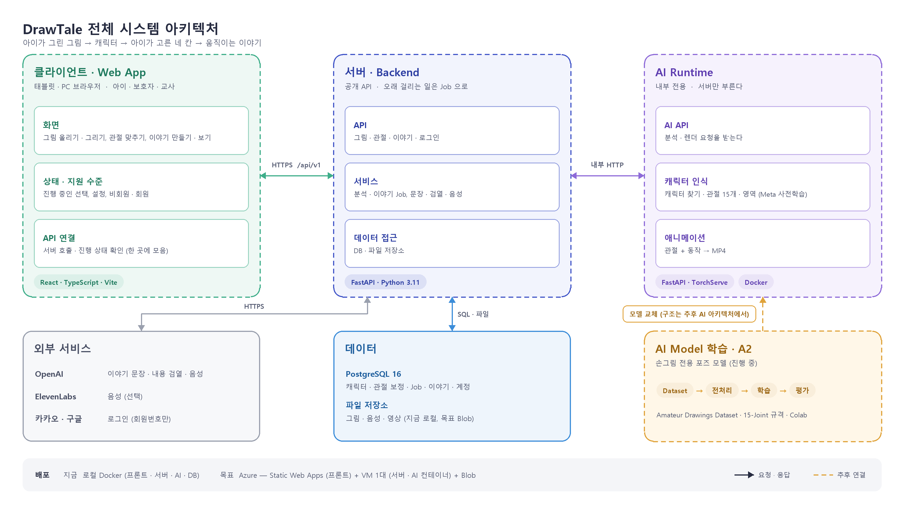
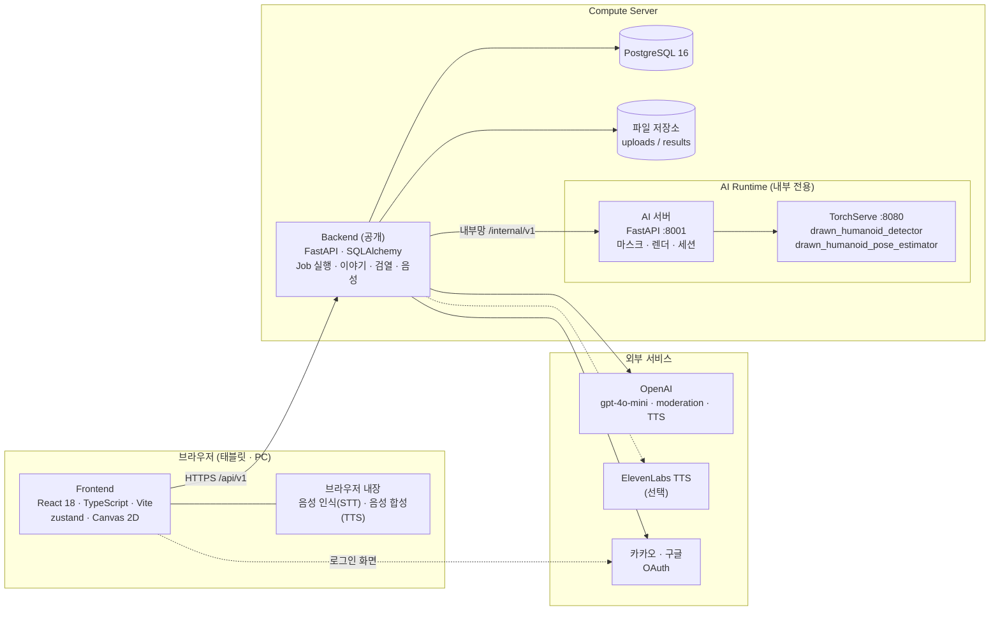
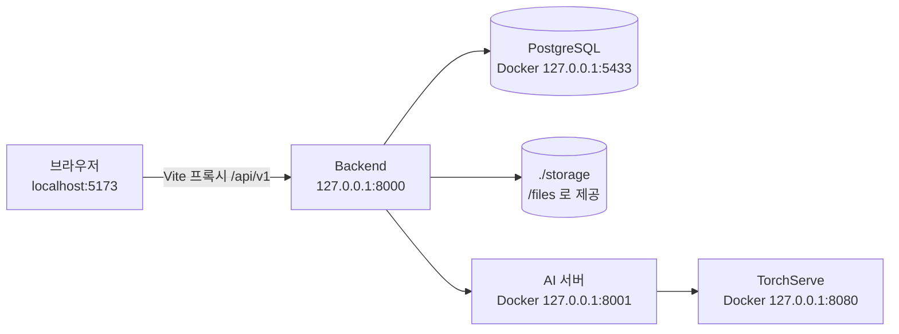
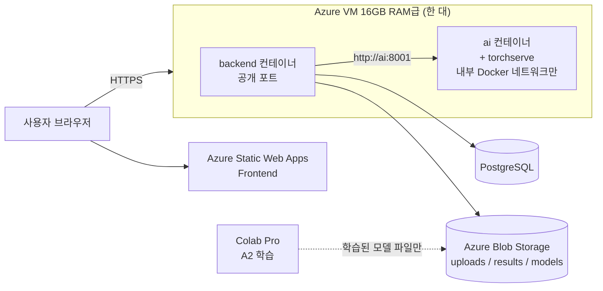
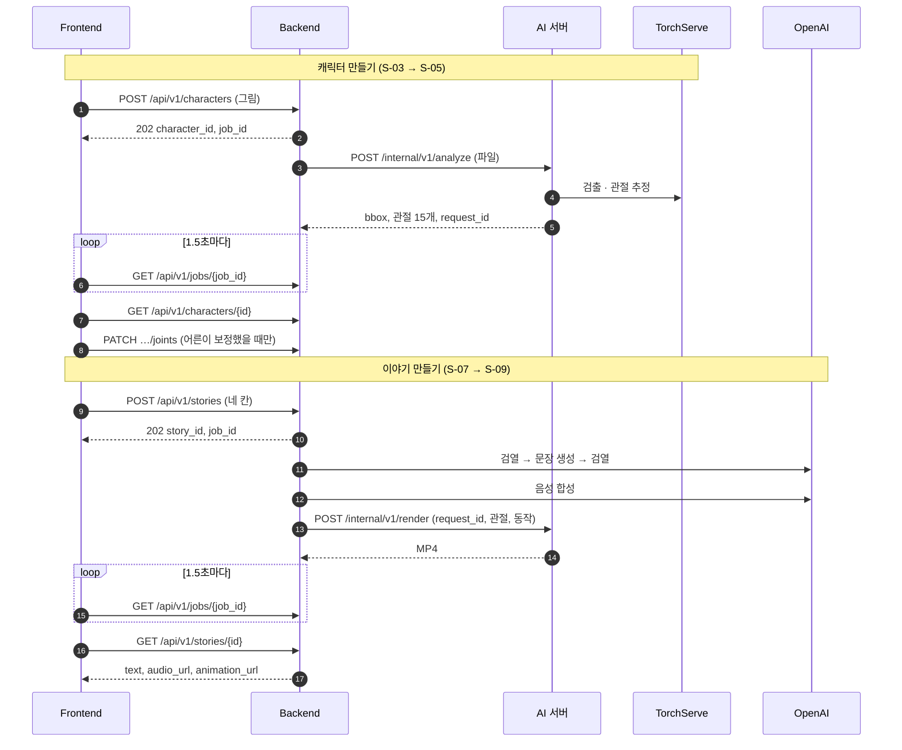

# 01. 시스템 아키텍처

| 항목 | 내용 |
|---|---|
| 문서 버전 | v0.2 |
| 기준일 | 2026-10-12 |
| 기준 코드 | 프론트 `feat/backend-contract` · 백엔드 `dev` · AI `feat/gentle-motions` |
| 근거 | 최종 인프라 구조 · 기능별 역할 정리(docx), 통합 정리 — 기술 구조와 예산(docx), 백엔드 API 계약 v0.1 |

> **이 문서는 무엇인가**
>
> 아이가 그림을 올리면, 그 그림이 여러 조각을 거쳐 움직이는 영상이 되어 돌아온다.
> 이 문서는 **그 조각들이 각각 무슨 일을 하고 어떻게 이어지는지** 적은 것이다.
> 5장에 「왜 이렇게 나눴나」가 있고, 8장에 기능이 실제로 어느 파일에 있는지가 있다.
> 무엇을 만드는지는 [02 기능 정의서](02-feature-spec.md)를 보면 된다.

번호 붙은 여덟 영역(클라이언트 · 네트워크 · 백엔드 · AI · 외부 서비스 · 데이터 · A2 학습 · 지금 상태)을 **누구나 읽을 수 있게 쉬운 말로, 칸마다 서너 줄만** 적은 한 장이다. 클라이언트 화면은 실제 앱(목 모드) 캡처다. 그림은 `tools/poster/architecture.html`을 Chrome 으로 찍어 만든다 (`npm install && node render.js`). 엔드포인트 · 모듈 · 테이블 컬럼 같은 세부는 아래 본문에 있다. A2 가 바꿀 포즈 모델의 구조는 아직 정하지 않아 「모델 교체 지점 (추후)」만 두었다 — 「10 AI 아키텍처」에서 다룬다.

## 한 줄 요약

**브라우저(React) → 공개 API(FastAPI) → 내부 AI 서버(FastAPI + TorchServe)** 세 층이다.
오래 걸리는 일(그림 분석, 이야기 생성)은 백엔드가 Job으로 돌리고 프론트는 상태를 묻는다.
외부 AI 업체(OpenAI 등)는 백엔드만 부르고, AI 서버는 백엔드만 부른다.

---

## 1. 구성도

---

## 2. 구성 요소

| 구성 요소 | 기술 | 맡은 일 | 저장소 |
|---|---|---|---|
| **Frontend** | React 18, TypeScript 5.6, Vite 5, react-router 6, zustand 4. 라이브러리 추가 없이 Canvas 2D | 화면 S-01~S-16, 그림 올리기·화면에 그리기, 관절 보정 UI, 브라우저 미리보기 애니메이션, Job 상태 묻기, 영상·음성 재생 | drawtale-frontend |
| **Backend** | Python 3.11, FastAPI, SQLAlchemy 2.1, Alembic, PostgreSQL 16, httpx | 공개 API, 파일 저장, Job 생성·실행, 관절 보정 저장, 이야기 문장 생성·검열, 음성 합성, AI 서버 호출, 소셜 로그인 | drawtale-backend |
| **AI 서버** | Python 3.10, FastAPI, OpenCV, Meta Animated Drawings, ffmpeg | 캐릭터 검출·관절 15개·마스크(analyze), 관절로 MP4 렌더(render), 분석 세션 보관 | drawtale-ai `runtime/` |
| **TorchServe** | Meta 사전학습 모델 (학습 없이 사용) | 사람 모양 캐릭터 검출, 관절 추정 | drawtale-ai `torchserve/` |
| **DB** | PostgreSQL 16 | 캐릭터, 관절 보정, Job, 이야기, 사용자, 소셜 계정, 토큰 | 백엔드 Alembic 마이그레이션 |
| **파일 저장소** | 지금 로컬 디스크 (`/files`로 제공). 목표 Azure Blob Storage | 올린 그림, 음성 mp3, 애니메이션 mp4 | 백엔드 `services/storage.py` |
| **모델 학습 (A2)** | Colab Pro, MMPose / RTMPose 계열 | 손그림 전용 포즈 모델 개발·평가. 기존 모델보다 나을 때만 교체 | drawtale-ai `training/` |

### 외부 서비스

| 서비스 | 쓰는 곳 | 없거나 실패하면 |
|---|---|---|
| OpenAI `gpt-4o-mini` | 네 칸을 짧은 이야기 네 문장으로 | 틀 문장 「오늘 나는 …에 갔어요. 그런데 ….」 |
| OpenAI `omni-moderation-latest` | 입력과 만든 문장을 **앞뒤로 두 번** 검사 | 걸리면 이야기를 만들지 않는다 (`CONTENT_BLOCKED`) |
| OpenAI `gpt-4o-mini-tts` 또는 ElevenLabs | 이야기 낭독 mp3 (`TTS_PROVIDER`) | 음성 없이 성공. 브라우저 음성으로 읽는다 |
| 카카오 · 구글 OAuth | 보호자·교사 로그인 (선택) | 비회원으로 쓴다 |
| 브라우저 음성 인식 (Web Speech API) | S-07 말로 덧붙이기 (어른이 켰을 때만) | 카드만으로 진행 |
| 브라우저 음성 합성 | 질문 읽기, 서버 음성이 없을 때 낭독 | 글자만 보인다 |

---

## 3. 배포 구성

### 3.1 지금 개발 구성 (로컬)

| 항목 | 값 |
|---|---|
| 프론트 | `npm run dev` (5173). `VITE_ENGINE=mock`이면 서버 없이 끝까지 돈다 |
| 백엔드 | `.venv`에서 uvicorn (8000), 또는 `docker compose --profile app up` |
| DB | `docker compose up -d db` (호스트 5433) |
| AI | drawtale-ai `docker compose up` (torchserve + ai). 백엔드 `AI_USE_MOCK=true`면 AI 없이도 돈다 |
| 확인된 것 | 실제 모델로 S-01~S-11이 끝까지 돈다 (2026-09-29) |

### 3.2 목표 배포 구성 (Azure, 아직 배포 전)

- **저장소 3개(Frontend · Backend · AI)를 유지**하고, 물리 서버는 한 대에서 컨테이너를 나눈다. 비용을 줄이되 Docker 이미지와 API 계약이 분리되어 있어 나중에 서버를 쉽게 나눌 수 있다
- 16GB는 서버 전체 메모리다. OS·Docker·Backend·AI가 함께 쓴다. 컨테이너별 상한은 실측으로 정한다 (예: Backend 2GB, AI 11~12GB)
- **AI 컨테이너는 외부에 공개하지 않는다.** 백엔드만 내부 네트워크로 부른다
- 올린 그림, 결과물, 모델 파일은 컨테이너 디스크가 아니라 영구 저장소(Blob)에 둔다
- GPU 서버를 따로 둘지는 학습 여부가 아니라 **실제 추론 지연 · 최대 메모리 · 동시 요청 성능**으로 정한다
- Blob 저장소 코드는 설정 자리(`STORAGE_BACKEND`, `AZURE_STORAGE_CONNECTION_STRING`)만 있고 아직 구현되지 않았다

---

## 4. 요청이 흐르는 길

단계별 분기는 [03. 플로우차트](03-flowchart.md)에 있다. 여기는 구성 요소 사이의 주고받기만 보인다.

| 단계 | 걸리는 시간 (실측) | 기다리는 한도 |
|---|---|---|
| 그림 분석 | 약 3~5초 | 프론트 30초 |
| 애니메이션 렌더 | 약 35~40초 (839프레임), 결과 0.6~1.7MB | 백엔드 AI 타임아웃 300초, 프론트 300초 |

---

## 5. 왜 이렇게 나눴나

구조를 보면 "굳이 이렇게까지?" 싶은 곳이 몇 군데 있다. 그렇게 한 이유를 적는다.

### 왜 Backend 와 AI 를 따로 두나

한 서버에 다 넣으면 통신할 일이 없어 더 간단하다. 그런데 **쓰는 것이 너무 다르다.**

| | Backend | AI 서버 |
|---|---|---|
| 파이썬 | 3.11 | **3.8** (Meta 코드가 요구한다) |
| 무거운 것 | 없음 | PyTorch · TorchServe (메모리 1.5GB) |
| 한 번에 걸리는 시간 | 0.1초 안 | 3초(분석) ~ 40초(렌더) |

한 프로세스에 넣으면 **파이썬 버전부터 맞출 수 없다.** 그리고 렌더가 40초 도는 동안
로그인이나 이야기 조회까지 같이 느려진다. 나눠 두면 AI 서버만 따로 끄고 켜도 되고,
A2 가 포즈 모델을 바꿔도 Backend 는 손대지 않는다.

### 왜 AI 서버는 바깥에서 못 부르나

AI 서버에는 **로그인 검사가 없다.** 안쪽에서만 부른다고 전제하고 만들었기 때문이다.
바깥에 열면 누구나 렌더를 돌릴 수 있고, 그만큼 서버 자원이 그대로 나간다.
그래서 주소를 공개하지 않고 Backend 만 부른다 (`/internal/v1`).

**오류 문구도 Backend 가 바꿔 준다.** AI 서버는 `NO_CHARACTER_DETECTED` 같은 코드를 주고,
Backend 가 그것을 아이가 읽을 수 있는 말로 옮긴다. 내부 사정이 화면까지 새지 않게 한다.

### 왜 바로 답하지 않고 Job 으로 하나

분석은 3~5초, 애니메이션은 35~40초가 걸린다. 그동안 응답을 붙들고 있으면
**브라우저나 중간 서버가 먼저 연결을 끊는다.** 보통 30초 안팎에서 끊긴다.

그래서 요청을 받으면 **곧바로 「접수했다」(202)만 답하고** 번호를 준다.
프론트는 그 번호로 1.5초마다 묻는다. 기다리는 화면을 보여 줄 수 있고,
연결이 잠깐 끊겼다 돌아와도 하던 일이 이어진다.

### 왜 하나가 실패해도 이야기를 돌려주나

이야기 한 편에는 문장 · 음성 · 영상 세 가지가 들어간다.
하나라도 실패하면 전부 실패로 처리하는 편이 코드가 단순하다.

그런데 아이 입장에서는 **40초를 기다렸는데 아무것도 못 받는 것**이 된다.
음성이 없어도 문장은 읽어 줄 수 있고, 영상이 없어도 이야기는 볼 수 있다.
그래서 되는 것까지는 돌려준다. **검열만 예외다** — 걸러야 할 내용은 일부라도 내보내지 않는다.

### 왜 프론트에 가짜 엔진(목)을 두나

서버 없이 화면만으로 끝까지 돌려볼 수 있게 했다 (`VITE_ENGINE=mock`).

프론트 담당자가 화면을 만들 때마다 백엔드 · AI 서버 · DB 를 전부 띄워야 한다면
**작업이 서로 막힌다.** 그리고 AI 서버는 메모리를 1.5GB 쓴다.
목 엔진이 있으면 화면 작업과 서버 작업을 따로 진행할 수 있고,
발표 시연도 서버 없이 할 수 있다.

### 5-1. 경계와 원칙

| 원칙 | 어떻게 지키나 |
|---|---|
| **API 키는 서버에만** | OpenAI · ElevenLabs · 카카오·구글 시크릿은 백엔드 환경변수에만 둔다. 프론트에는 소셜 client id만 |
| **화면은 업체 이름을 모른다** | 프론트는 우리 `/api/v1`만 부른다. TTS 업체가 바뀌어도 프론트는 그대로다 |
| **서버 호출은 한 곳으로** | 프론트의 모든 서버 호출은 `src/api/index.ts`를 지난다. 서버 응답 모양과 오류 코드 변환도 여기에만 있다 |
| **AI 서버는 내부 전용** | 백엔드만 `AI_SERVICE_URL`로 부른다. AI 오류 코드는 백엔드가 사용자용 문장으로 바꾼다 |
| **엔진 교체 지점은 하나** | 프론트 `VITE_ENGINE`(mock · agent · finetuned), 백엔드 `AI_USE_MOCK`. 응답 형식은 바뀌지 않는다 |
| **모델 교체는 계약 뒤에서** | A2 모델이 Meta 포즈 모델보다 실제 평가셋에서 낫고 CPU 추론이 충분할 때만 AI 서버의 포즈 부분을 바꾼다. 백엔드·프론트는 모른다 |
| **외부 장애로 멈추지 않는다** | 아래 표 |

### 무엇이 없어도 이야기는 만들어진다

| 없거나 실패한 것 | 대신 하는 것 |
|---|---|
| `OPENAI_API_KEY` 없음, 문장 생성 실패 | 틀 문장 |
| 음성 합성 실패 | `audio_url: null` → 브라우저 음성 |
| AI 서버가 순화 동작을 모름 (`UNKNOWN_MOTION`) | 원래 동작으로 다시 렌더 |
| 목 AI, 또는 AI 세션 없음 | 애니메이션 자리에 원본 그림 |
| 검열에 걸림 | **대신하지 않는다.** 이야기를 만들지 않고 아이에게 다시 고르게 한다 |

---

## 6. 데이터가 사는 곳

| 데이터 | 위치 | 비고 |
|---|---|---|
| 캐릭터 (크기, bbox, AI 관절, AI 세션 id, 모델 버전) | DB `characters` | 관절 좌표는 원본 픽셀 기준 |
| 관절 보정 이력 | DB `joint_corrections` | 가장 최근 보정을 렌더에 쓴다 |
| Job (종류, 상태, 오류 코드) | DB `jobs` | `analyze` · `story` |
| 이야기 (네 칸, 문장, 음성·영상 경로) | DB `stories` | |
| 사용자, 소셜 계정, 로그인 토큰 | DB `users` · `social_accounts` · `auth_tokens` | 제공자 회원번호만. 토큰은 SHA-256 해시 |
| 올린 그림 | Blob `uploads/` | 원본 보관이 꺼져 있으면 그림을 떠날 때, 늦어도 24시간 뒤 지운다 |
| 음성 · 애니메이션 | Blob `results/{story_id}.mp3 · .mp4` | 읽기는 2시간짜리 SAS 주소로만 연다 |
| AI 분석 세션 (원본, 마스크, 분석 JSON) | AI 서버 작업 폴더 `request_id/` | render에서 재사용. `DELETE /internal/v1/sessions/{id}`로 정리. AI 서버를 다시 켜면 사라진다 |
| 이야기 목록, 설정, 토큰, 체험 사용 수 | 브라우저 저장소 | [04. 화면 설계서 11장](04-screen-spec.md#11-계정과-데이터) |

테이블 구조와 관계는 「12. DB ERD」 문서에서 다룬다.

---

## 7. 개인정보와 안전

| 항목 | 설계 |
|---|---|
| 아이 계정 | 없다. 계정은 보호자·교사의 것이다 |
| 소셜 로그인 | 동의 항목을 요청하지 않는다. 제공자 회원번호만 저장한다 |
| 아이 그림 | 이름·얼굴이 찍힐 수 있다. 원본 보관 기본 꺼짐, 그림을 떠날 때 삭제 (구현 완료). **사진과 그림을 구분하지 못한다 — 05 6-1** |
| 아이 목소리 | 기본 꺼짐. 어른이 켜면 브라우저 음성 인식으로 글자만 받는다. 녹음 파일은 없다 |
| 이야기 내용 | 입력과 결과를 검열한다. 무섭거나 슬픈 결말을 쓰지 않도록 문장 생성 규칙에 둔다 |
| 비회원 | 이야기는 탭을 닫으면 사라진다. 기기에는 체험 사용 수(정수 하나)만 남는다 |

---

## 8. 기능이 어디에, 어떻게 구현되어 있나

「02 기능 정의서」는 **무엇이 되어야 하는가**를 정한다.
여기는 그것이 **어디에 어떻게 구현되어 있는가**를 적는다.
기능 정의서 v0.2에서 옮겨 온 내용이다.

### 8.1 기능 → 모듈

| 기능 | 어디에 |
|---|---|
| F-ACC-01 · 02 비회원 시작 · 체험 한도 | FE `store/auth.ts`, `TRIAL_LIMIT` |
| F-ACC-03 ~ 06 소셜 로그인 | BE `services/social.py` · `core/auth.py`, FE `api/auth.ts` |
| F-DRW-02 사진 올리기 | FE `lib.shrink` (긴 변 1600px, JPEG 0.85) |
| F-DRW-03 화면에 그리기 | FE `features/draw/drawing.ts` |
| F-CHR-01 분석 Job | BE `services/jobs.py` · `api/v1/characters.py` |
| F-CHR-02 검출 · 관절 추정 | AI `analyzer.py` → TorchServe |
| F-CHR-03 마스크 생성 | AI `analyzer.build_mask` |
| F-CHR-04 미리보기 | FE `features/character/CharacterCanvas` |
| F-CHR-05 관절 보정 | BE `joint_corrections` 테이블, FE S-06 |
| F-CHR-06 신뢰도 안내 | AI 점수 → BE 계약 2-3 → FE `needsAdult` |
| F-STY-01 카드 고르기 | FE `features/story/choices.ts` |
| F-STY-02 말로 덧붙이기 | FE `features/story/voice.ts` (브라우저 STT) |
| F-STY-03 읽어 주기 | FE `lib.speak` (브라우저 TTS) |
| F-STY-04 · 05 문장 · 검열 | BE `services/story_writer.py` |
| F-STY-06 음성 | BE `services/tts.py` |
| F-STY-07 애니메이션 | BE `motion_for` → AI `renderer.py` |
| F-LIB-01 목록 | FE `store/library.ts` (비회원 `sessionStorage`, 회원 `localStorage`) |
| F-SET-02 지원 수준 | FE `LEVEL_CONFIG` + CSS 변수 |
| F-SET-04 원본 삭제 | BE `services/originals.py`, `DELETE /characters/{id}/original` |
| F-COM-01 오류 화면 | FE `api/index.ts ERROR_MAP`, `lib.ERROR_TEXT` |
| F-COM-02 연결 끊김 | FE `OfflineBar`, `api/index.ts waitJob` |
| **누가 볼 수 있는지** | BE `core/authz.py` — 주인이 있는 자료는 그 계정만. 남의 것은 **404** |

### 8.2 주요 처리 세부

| 무엇 | 어떻게 |
|---|---|
| **캐릭터 검출 · 관절 추정** | 긴 변 1000px로 줄여 검출 → 포즈 추정. 좌표를 **원본 픽셀 기준으로 되돌려** 반환 |
| **마스크 생성** | 적응형 이진화 → 닫힘 · 팽창 → flood fill, 가장 큰 덩어리 하나. 닫힘 횟수를 2 → 6 → 12 → 20으로 올려 가며 재시도하고, 관절이 마스크 위에 얹히는 비율로 뒤집힘을 판정 |
| **관절 보정 반영** | 보정 이력 중 **가장 최근 것**을 렌더에 쓴다. 보정이 없으면 AI 관절 |
| **이야기 문장** | `gpt-4o-mini`. 정확히 네 문장, 15~25자, 쉬운 낱말, 주인공 「나」, 「~어요」, 무섭거나 슬픈 결말 금지. 키가 없거나 실패하면 틀 문장 |
| **검열** | 입력과 결과를 **앞뒤 두 번** `omni-moderation-latest`로 검사 |
| **동작 선택** | 행동 문구에 달려 · 뛰 · 점프 · 춤 · 운동이 있으면 `jumping_gentle`, 그 밖은 `wave_hello_gentle` |
| **렌더** | 보정 관절 + 마스크 → 화면 없는 환경에서 GIF 렌더 → ffmpeg으로 MP4 변환 |
| **지원 수준** | 화면을 세 벌 만들지 않는다. 설정값과 CSS 변수만 바꾼다 |
| **Job 대기** | 프론트가 1.5초마다 상태 조회. 분석 30초 · 이야기 300초 한도 |
| **자료의 주인** | 로그인하고 올리면 `characters.user_id` 에 찍힌다. 이야기 · Job 은 그림을 따라간다. 로그인하지 않고 올린 것은 주인이 없어 주소로 연다 |

### 8.3 판정 기준값

| 값 | 쓰이는 곳 |
|---|---|
| 검출 신뢰도 0.6 | 미만이면 어른 도움 링크 |
| 관절 점수 0.4 | 미만인 관절을 보정 화면에 표시 |
| 관절 평균 0.35 | 미만이면 `LOW_CONFIDENCE` |
| 두 번째 검출 0.8 · 겹침 50% | 넘으면 `MULTIPLE_CHARACTERS` |

> 이 네 값은 **Meta 예제 그림으로 정했고 아동 그림으로 재측정하지 않았다.**
> 재측정 계획은 「05 입력 그림 요구사항」 3장에 있다.

---

## 9. 아직 정하지 않은 것

| 항목 | 지금 | 정할 것 |
|---|---|---|
| Azure 배포 | 로컬만 | VM 사양, 도메인, HTTPS, 배포 순서 |
| AI에 파일 전달 | multipart 직접 전송 | URL(Blob)로 줄지 — 파일이 커지면 재검토 |
| Job 실행 | FastAPI `BackgroundTasks` (백엔드 프로세스 안) | 백엔드를 다시 켜면 진행 중 Job이 사라진다. 큐(예: 별도 워커)를 둘지 |
| AI 세션 보관 | AI 서버 디스크, 만료 규칙 없음 | 보관 기간, 이야기 생성 후 정리 |
| 비회원 자료를 계정으로 옮기기 | 비회원으로 만든 그림 · 이야기는 주인이 없다 | 로그인했을 때 그전 것을 계정에 붙일지 |
| 신뢰도 기준값 | Meta 예제 그림으로 정함 | 아동 그림으로 재측정 (`05` 3장) |
| 동시 요청 | 측정 전 | 한 서버에서 렌더 몇 개를 동시에 돌릴 수 있는지 실측 |
| **요청 수 제한** | 정책은 정했으나(`02` 6-1) 아직 넣지 않았다. 숫자는 초안이다 | 부하를 재어 보고 기준값을 정한다 |
| **데이터 보관 기한** | 원본 그림만 24시간. 캐릭터 · 이야기 · Job · AI 세션은 기한 없음 | 각각 언제까지 둘지 |
| **로그에 무엇을 남길지** | 정하지 않음 | 아이 그림 · 이야기 문장이 로그에 남지 않게 |

---

## 10. 이어지는 문서

| 문서 | 이 문서에서 이어받는 것 |
|---|---|
| 05 입력 그림 요구사항 | 받아들이는 그림의 범위와 요구사항 |
| 06 현장 자문 계획 | 설계 가정의 검증 계획 |
| 07 소프트웨어 아키텍처 | 2장의 구성 요소를 저장소별 모듈로 나눈다 |
| 08 프로세스 아키텍처 | 4장의 Job · 렌더를 실행 단위와 동시성으로 |
| 09 서버 아키텍처 | 3장의 배포 구성을 컨테이너 · 네트워크 · 배포 절차로 |
| 10 AI 아키텍처 | AI 서버 · TorchServe 파이프라인과 A2 모델 교체 지점 |
| 11 웹앱 아키텍처 | 프론트의 화면 · 상태 · API 계층 |
| 12 DB ERD | 6장의 테이블과 관계 |
