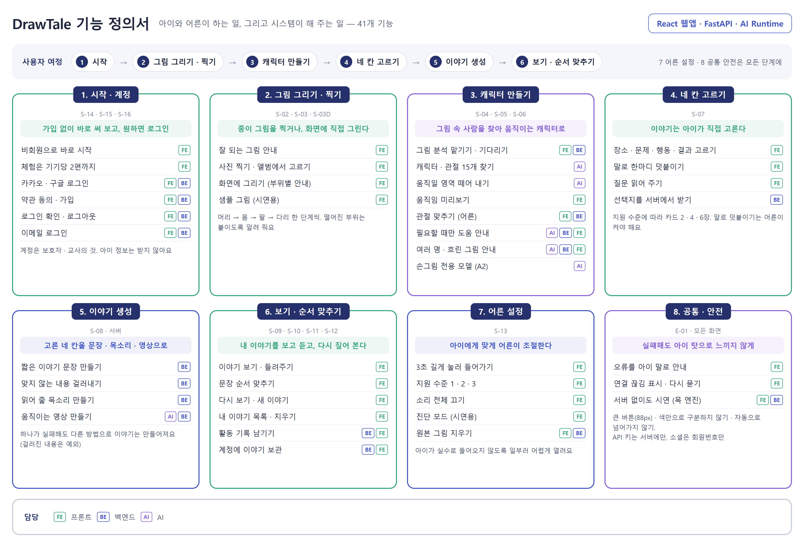

# 03. 기능 정의서

| 항목 | 내용 |
|---|---|
| 문서 버전 | v0.2 |
| 기준일 | 2026-10-12 |
| 근거 | 화면 설계서 v0.3, 입력 그림 요구사항(`06`), 백엔드 API 계약 v0.1 |

> **v0.1 → v0.2 변경**
> v0.1은 구현과 병행해 쓰여 기능 기록에 가까웠다. v0.2에서 **대상 · 가치 · MVP 범위를 앞에 두고**,
> 기능마다 **완료 기준**을 붙였다. 구현 내용(파일명 · 알고리즘 · 임계값)은 「02 시스템 아키텍처」로
> 옮겼고, 개발 도구는 사용자 기능과 분리해 부록 A로 뺐다.



> **이 문서는 무엇인가**
>
> **무엇을 만들고 무엇은 만들지 않는지** 정한 문서다.
> 앞쪽(1~3장)에 누구를 위한 서비스이고 어디까지 만드는지가 있고,
> 뒤쪽(4~5장)에 기능 하나하나의 목적과 「이러면 끝났다」는 기준이 있다.
> 어떻게 만들었는지는 [02 시스템 아키텍처](02-system-architecture.md) 8장에 있다.


---

## 1. 누구를 위해, 무엇을 푸는가

### 1-1. 대상

| 구분 | 누구 | 상황 |
|---|---|---|
| **사용자** | **배움이 천천히 가는 아이** (만 5세부터, 나이 상한 없음) | 글자를 읽지 못할 수 있다. 소근육 조작이 어려울 수 있다. **어른이 곁에 있는 것을 전제로 한다** |
| **계정 주인** | **보호자** (부모 · 후견인) | 계정을 만들고 **법정대리인 동의를 직접 한다.** 설정을 조정하고 관절을 고쳐 준다 |
| | **교사** (특수교사 · 치료사) | 계정을 만들고 프로필을 두되, **동의는 각 아이의 보호자에게 받아야 한다** |

**가입과 동의 없이는 서비스를 쓸 수 없다.** 한 계정에 아이 프로필을 여러 개 둘 수 있다.

아이는 계정을 갖지 않는다. 집 · 교실 어디서나 쓴다.

> **의학적 진단을 기준으로 대상을 나누지 않는다.**
> 「발달장애」 「경계선 지능」 같은 진단명으로 대상을 정의하면
> 그 진단을 받지 않은 아이는 쓸 수 없는 것처럼 보이고, 받은 아이에게는 낙인이 된다.
> **나이나 진단이 아니라 아이에게 맞는 지원 수준으로 조절한다** (F-SET-02).
>
> 나이 상한을 두지 않는 이유도 같다. 15세인데 천천히 가는 아이를 막을 이유가 없다.

**대상에 넣지 않는 것**

| 누구 | 왜 |
|---|---|
| **치매 등 인지 저하가 있는 성인 · 노인** | 필요한 설계가 다르다. 회상을 돕는 활동, 요양 현장의 돌봄 인력, 의료 기기에 준하는 검토가 따로 필요하다. **쓰는 것을 막지는 않지만 그분들을 위해 만든 서비스가 아니다** |

화면 문구와 그림이 아이를 기준으로 만들어져 있어, 성인에게는 맞지 않는다.

### 1-1-1. 아이와 어른이 각각 하는 일

> **기본 흐름은 아이가 스스로 진행한다.
> AI가 확신하지 못하는 단계에서만 어른이 들어온다.**

어른이 늘 붙어 있어야 하는 서비스가 아니고, 아이가 모든 것을 혼자 해야 하는 서비스도 아니다.
**평소에는 아이가 하고, 막히는 지점에서만 어른을 부른다.**

| | 누가 | 언제 |
|---|---|---|
| 그림 올리기 · 그리기 | **아이** | 늘 |
| 캐릭터 확인 | **아이** | 늘 |
| **관절 고치기** | **어른** | **AI 점수가 낮을 때만** (F-CHR-06 → F-CHR-05) |
| 네 칸 고르기 · 이야기 보기 · 순서 맞추기 | **아이** | 늘 |
| 지원 수준 · 소리 · 원본 보관 설정 | 어른 | 처음 한 번 |
| 로그인 | 어른 | 쓰고 싶을 때만 |

관절 고치기(S-06)와 설정(S-13)은 **어른 화면**이라 글자가 작고 음성 안내가 없다.
그 밖의 화면은 전부 아이 화면이다.

### 1-2. 푸는 문제

이야기를 만들고 꾸미는 활동은 아이에게 즐거운 일이다.
그런데 **글자와 빈 종이 앞에서 시작 자체가 막히는 아이**가 있다.
무엇을 써야 할지 떠올리기 어렵고, 떠올려도 글로 옮기기 어렵다.
그래서 이 활동에서 먼저 밀려난다.

AI에게 이야기를 대신 쓰게 하면 이 문제는 사라지지만 **활동의 재미도 함께 사라진다.**
아이가 만든 것이 아니기 때문이다.

> **치료나 학습 효과를 내세우지 않는다.**
> 「이 활동을 하면 언어 능력이 좋아진다」고 주장하려면 그만한 검증이 필요하고,
> 그것은 이 서비스의 목표가 아니다.
> 우리가 하려는 것은 **아이가 재미있게 만들어 보고, 자기가 만든 것을 보는 경험**이다.

### 1-3. 핵심 가치

> **AI가 동화를 대신 만들어 주지 않는다. 이야기를 구성하는 주체는 아이다.**

AI는 아이가 고른 네 칸을 문장으로 다듬고, 아이 그림을 움직이게 하는 일만 한다.

| 누구 | 무엇을 얻는가 |
|---|---|
| **아이** | 글자를 몰라도 이야기를 **직접 만든다.** 내가 그린 그림이 주인공이 되어 움직이는 것을 본다. **내가 만들었다는 경험** |
| **보호자** | **아이와 함께 할 거리**가 생긴다. 아이가 무엇을 고르는지 보면서 이야기를 나눈다 |
| **교사** | 교실에서 쓸 수 있는 활동이 하나 생긴다. 아이가 몇 번 만에 해냈는지 기록이 남는다 |

**가운데 줄이 이 서비스의 모양을 정한다.** 아이 혼자 쓰는 앱이 아니라
**어른과 아이가 같이 하는 활동**이다. 그래서 어른 화면을 따로 두고(S-06 · S-13),
아이가 막히는 지점에서 어른을 부른다.

**기능을 더하거나 문구를 정할 때 이 문장을 기준으로 삼는다.**

### 1-4. 이 정의의 근거

| 무엇 | 어디서 | 상태 |
|---|---|---|
| 대상 규모 · 지원 공백 | 경계선 지능 첫 실태조사(한국보건사회연구원, 2026) — 아동 · 청소년 5.1% 위험군, 보호자 85.1%가 사비 지출. 특수교육통계 124,195명 | [출처 4 · 5](presentation/sources.md) |
| 양육 · 교육 환경의 어려움 | 보호자 경험 연구 3건 (김초은 외 2023, 손성화 · 백수진 2025, 임희진 · 구자경 2019) | [출처 1 ~ 3](presentation/sources.md) |
| 그림 · 이야기 활동의 가치 | Pitri & Michaelidou (2025) 서사적 그리기와 초기 문해. **아동 1명 사례연구라 「가능성」으로만 쓴다. 효과를 주장하는 근거로 쓰지 않는다** | [출처 6](presentation/sources.md) |
| 표현 매체를 여러 개 둘 것 | CAST UDL Guidelines 3.0 — drawing · storytelling · animation | [출처 7](presentation/sources.md) |
| **AI가 대신 만들면 안 되는 이유** | Alan Turing Institute (2025) — 「generative AI adds value **alongside – not instead of**」 | [출처 12](presentation/sources.md) |
| 기존 서비스의 공백 | Drawings Alive · Drawalive · Meta 데모 조사 — **아이가 이야기를 고르는 기능이 없다** | [출처 10 · 11](presentation/sources.md) |

> **배경조사의 경계선 지능 연구들은 「왜 이런 활동이 필요한가」를 보이는 데 쓴다.**
> 그 진단을 받은 아이를 대상으로 한정한다는 뜻이 아니고,
> 이 서비스가 그 아이들을 치료한다는 뜻은 더더욱 아니다.
>
> **여기까지는 전부 문헌 · 공개 자료다.** 현장 전문가나 보호자를 만난 기록은 아직 없다.
> 아래 설계(지원 수준, 네 칸 구조, 카드 수, 상호작용 수치)는 **검증되지 않은 가정**이며,
> 검증 계획은 「07 현장 자문 계획」에 있다.

---

## 2. MVP 범위

### 2-1. 필수를 가르는 기준

> **아이가 그림에서 이야기 영상까지 가는 데 필요한가?**
> **또는 AI가 실패했을 때 되살리는 데 필요한가?**

둘 중 하나에 해당하면 **필수**, 없어도 끝까지 갈 수 있으면 **선택**이다.
「발표 시연에 있어야 하는가」가 아니다.

기준이 두 줄인 이유는 1-1-1에 있다. **평소에는 아이가 혼자 가지만,
AI가 틀렸을 때 어른이 되살리는 길도 함께 있어야 끝까지 간다.**
관절 고치기(F-CHR-05)가 어른 기능인데도 필수인 것이 그래서다.
이 길이 없으면 관절이 어긋난 그림은 거기서 멈춘다.

이 기준으로 보면 로그인 · 보관 · 음성은 전부 선택이고,
**읽어 주기 · 지원 수준 · 오류 안내는 필수**다. 글자를 못 읽는 아이가 혼자 가려면 꼭 있어야 하기 때문이다.

### 2-2. 이번에 만드는 것

| 묶음 | 내용 |
|---|---|
| 그림 넣기 | 사진 찍기 · 앨범 · **화면에 그리기** |
| 캐릭터 만들기 | 관절 15개 자동 인식, 어른이 고치기, 미리보기 |
| 이야기 만들기 | 네 칸 카드 고르기 → 문장 → 애니메이션 |
| 이야기 보기 | 재생 · 순서 맞추기 · 완료 |
| 맞추기 | 지원 수준 1 · 2 · 3 |
| 안전 | 내용 검열, 원본 그림 삭제, 오류 안내 |

받아들이는 그림의 범위는 **「06 입력 그림 요구사항」**에서 정한다.
요약하면 **두 발로 선 캐릭터 한 명**이고, 사람 · 로봇 · 두 발로 선 동물이 모두 들어간다.

### 2-2-1. 어디까지 되면 MVP 가 끝난 것인가

기능이 계속 늘어나므로 **끝나는 지점**을 적어 둔다.
아래 여덟 가지가 **실제 서버 · 실제 모델로 한 번에 이어지면** 핵심 흐름이 끝난 것으로 본다.

| # | 이것이 되면 |
|---|---|
| 0 | **보호자가 가입하고 아이 프로필을 만든다** (만 14세 미만이면 법정대리인 동의) |
| 1 | 그림을 올린다 (**화면에 그리기**. 사진은 어른이 켠 경우) |
| 2 | AI 가 캐릭터를 찾아낸다 |
| 3 | 관절 15개를 화면에서 확인한다 |
| 4 | 어긋난 관절을 어른이 고칠 수 있다 |
| 5 | 네 칸을 고른다 |
| 6 | 이야기 문장이 나온다 |
| 7 | 아이 그림이 움직이는 영상이 나온다 |
| 8 | 만든 이야기를 다시 본다 |

**읽어 주는 음성(F-STY-06), 순서 맞추기(F-PLY-02), 지원 수준(F-SET-02), 로그인(F-ACC)은
이 여덟 가지와 따로 센다.** 서비스에 필요하지만, 없다고 해서 그림이 영상이 되지 못하는 것은 아니다.

> **2026-10-12 기준으로 여덟 가지가 모두 한 번씩 동작했다.**
> 다만 각자 로컬에서 띄운 환경이고, 배포한 서버에서 확인한 것은 아니다.

### 2-3. 만들지 않는 것

| 항목 | 이유 |
|---|---|
| 네 발 동물 · 새 · 곤충 캐릭터 | 종류마다 스켈레톤 · 모션 데이터 · 리타게팅 · 포즈 모델이 따로 필요하다. 종류당 한 달 이상 (`06` 2장) |
| 한 그림에 여러 캐릭터 | 모델이 가장 높은 하나만 쓴다 |
| AI가 이야기를 이끄는 대화형 생성 | 「구성 주체는 아이」에서 멀어진다. 검수가 어렵고 턴마다 지연 · 비용이 쌓인다 |
| 아이 계정 · 아이 개인정보 | 계정은 보호자 · 교사의 것이다 |
| 모델 재학습으로 Meta 모델 대체 | 측정으로 필요가 확인되고, 기존보다 나을 때만 (F-CHR-08) |
| 교사용 기록 화면 | 데이터는 쌓지만(F-PLY-04) 보여 주는 화면은 다음 단계 |

---

## 3. 제약

여기저기 흩어져 있던 기술적 한계를 한곳에 모았습니다. **기능을 설계할 때 넘을 수 없는 선입니다.**

| ID | 무엇이 안 되나 | 어떤 뜻인가 | 왜 그런가 |
|---|---|---|---|
| C-01 | 캐릭터 모양 | 두 발로 선 모습만 알아봅니다 | 관절을 찾는 모델이 사람 모양 15관절만 다룹니다 |
| C-02 | 캐릭터 수 | 한 그림에 한 명만 씁니다 | 모델이 가장 뚜렷한 한 명만 고릅니다 |
| C-03 | 관절 정확도 | 어깨와 목이 어긋나게 잡힙니다. 뒤에서 고쳐 보았지만 나아지지 않았습니다 | 모델이 사진으로 배워서 손그림에 덜 맞습니다 |
| C-04 | 움직임 종류 | 지금은 손 흔들기와 점프 두 가지뿐입니다. **여섯 가지로 늘릴 계획입니다** (5.4) | 가진 동작 데이터가 그만큼입니다 |
| C-04b | **행동 카드 6장 중 5장이 같은 영상** | 「달려갔어요」만 점프가 나오고 나머지는 모두 손 흔들기입니다 | 움직임이 두 가지뿐이기 때문입니다 (C-04) |
| C-05 | 영상 만드는 시간 | 35~40초 걸립니다 | 한 장씩 그린 뒤 영상으로 바꾸기 때문입니다 |
| C-06 | 배경 | 배경이 캐릭터와 밝기가 비슷하면 움직일 영역을 떼어 내지 못합니다 | 밝기 차이로 캐릭터를 가려냅니다 |
| C-07 | 사진과 그림 | 가려내지 못합니다. 오히려 사람 사진이 더 잘 통과합니다 | 가려낼 모델이 없습니다 (`06` 6-1) |
| C-08 | 말하기 | 크롬과 사파리에서만 됩니다 | 브라우저가 주는 기능을 씁니다 |

C-03은 A2가 만드는 **손그림 전용 모델로 나아지기를 기대하는 항목**입니다 (F-CHR-08).
그때까지는 어른이 관절을 고칠 수 있게 해 두었습니다 (F-CHR-05).

> **C-04b는 핵심 가치와 부딪히는 지점입니다.**
> 아이가 행동 카드를 골라도 「달려갔어요」가 아니면 **영상은 모두 손 흔들기**입니다.
> 「숨었어요」를 골라도 「기다렸어요」를 골라도 같은 영상이 나옵니다.
> 「이야기를 구성하는 주체는 아이」라고 해 놓고 **아이의 선택이 결과에 거의 드러나지 않습니다.**
> 움직임을 늘릴지, 아니면 카드를 움직임에 맞춰 줄일지 정해야 합니다.
>
> **이것은 골격을 하나만 받기로 한 것과 같은 뿌리입니다.**
> 「고를 수 있는 행동」과 「그 행동을 움직임으로 바꾸는 규칙」은 한 몸이라,
> 한쪽만 늘릴 수 없습니다 ([06 2장](06-input-guideline.md)).

---

## 4. 기능 목록

### 4-0. 먼저, 아이가 하는 일의 순서

기능 ID 를 읽기 전에 **아이가 실제로 무엇을 하는지** 보는 편이 빠르다.

```
그림 준비  →  캐릭터 만들기  →  캐릭터 확인  →  네 칸 고르기  →  이야기 만들기  →  이야기 보기
```

**① 그림 준비** — 종이에 그린 그림을 찍거나, 화면에 직접 그린다.
화면에 그릴 때는 머리 → 몸 → 팔 → 다리 순서로 한 부위씩 그린다.
→ `F-DRW-01` ~ `F-DRW-03`

**② 캐릭터 만들기** — 올린 그림에서 AI 가 사람 모양을 찾고, 관절 15개와 움직일 영역을 뽑아낸다.
오래 걸리므로 기다리는 화면을 보여 준다.
→ `F-CHR-01` ~ `F-CHR-03`

**③ 캐릭터 확인** — 아이가 캐릭터를 눌러 바로 움직여 본다.
**AI 가 자신 없어 한 관절이 있을 때만** 어른을 불러 고치게 한다.
→ `F-CHR-04` ~ `F-CHR-07`

**④ 이야기 정하기** — **두 가지 길이 있다.**
**카드로 고르거나**(장소 → 문제 → 행동 → 결과), **보호자와 함께 말로 하거나**.
글자를 못 읽어도 질문과 카드를 읽어 준다.
→ `F-STY-01` ~ `F-STY-03`, `F-STY-09`

**⑤ 이야기 만들기** — 고른 네 칸이 네 문장이 되고, 읽어 주는 음성과
아이 그림이 움직이는 영상이 만들어진다. 만들기 전후로 내용을 검사한다.
→ `F-STY-04` ~ `F-STY-07`

**⑥ 이야기 보기** — 영상을 보며 이야기를 듣는다.
문장을 섞어 놓고 순서를 다시 맞춰 본다.
→ `F-PLY-01` ~ `F-PLY-04`

그 밖에 **만든 이야기를 다시 보는 기능**(`F-LIB`), **어른이 조절하는 설정**(`F-SET`),
**로그인**(`F-ACC`), **오류 안내와 연결 끊김 처리**(`F-COM`)가 있다.

### 4-1. 전체 목록

**사용자 기능 43개.** (F-ACC-02 는 가입을 필수로 바꾸면서 뺐다.)
개발 도구 3개는 부록 A에 따로 둔다.

| ID | 기능 | 화면 | 담당 | 우선순위 |
|---|---|---|---|---|
| F-ACC-01 | 처음 실행 안내 | S-14 | FE | 필수 |
| F-ACC-02 | ~~비회원 체험 한도~~ | — | — | **뺌** |
| F-ACC-03 | 소셜 로그인 (카카오 · 구글) | S-15, S-15C | FE · BE | **필수** |
| F-ACC-04 | 가입 · 약관 동의 | S-16 | FE · BE | **필수** |
| F-ACC-05 | 이메일 로그인 · 가입 | S-15, S-16 | FE · BE | 선택 |
| F-ACC-06 | 로그인 확인 · 로그아웃 | S-13 | FE · BE | **필수** |
| F-ACC-07 | **아이 프로필 만들기 · 법정대리인 동의** (보호자) | 새 화면 | FE · BE | **필수** |
| F-ACC-08 | 아이 프로필 여러 개 · 고르기 | 새 화면 | FE · BE | **필수** |
| F-ACC-09 | **교사 계정 — 보호자에게 동의 받기** | 새 화면 | FE · BE | 선택 (다음 단계) |
| F-DRW-01 | 그림 그리기 안내 | S-02 | FE | 필수 |
| F-DRW-02 | 사진 찍기 · 앨범에서 고르기 | S-03 | FE | **선택** (어른이 켜야 보임) |
| F-DRW-03 | 화면에 그리기 (부위별 안내 · 도장) | S-03D | FE | **필수** |
| F-CHR-01 | 그림 올리기 · 분석 Job | S-04 | FE · BE | 필수 |
| F-CHR-02 | 캐릭터 검출 · 관절 15개 추정 | S-04 | AI | 필수 |
| F-CHR-03 | 캐릭터 마스크 생성 | S-04 | AI | 필수 |
| F-CHR-04 | 캐릭터 확인 · 움직임 미리보기 | S-05 | FE | 필수 |
| F-CHR-05 | 관절 보정 (어른) | S-06 | FE · BE | 필수 |
| F-CHR-06 | 관절 신뢰도로 도움 안내 | S-05, S-06 | AI · BE · FE | 선택 |
| F-CHR-07 | 범위 밖 그림 걸러내기 · 안내 | E-01 | AI · BE · FE | **필수** |
| F-CHR-08 | 손그림 전용 포즈 모델 (A2) | — | AI | 선택 |
| F-STY-01 | **카드로 이야기 만들기** (네 칸) | S-07 | FE | 필수 |
| F-STY-02 | 말로 덧붙이기 | S-07 | FE | 선택 (어른이 켜야) |
| F-STY-09 | **말로 이야기 만들기** (AI 질문 → 어른 전달) | S-07 | FE · BE | 선택 |
| F-STY-03 | 질문 읽어 주기 | 아이 화면 전체 | FE | 필수 |
| F-STY-04 | 이야기 문장 만들기 | S-08 | BE | 필수 |
| F-STY-05 | 내용 검열 | S-08, E-01 | BE | 필수 |
| F-STY-06 | 이야기 음성 만들기 | S-08 | BE | 선택 |
| F-STY-07 | 애니메이션 렌더 (순화 동작) | S-08 | AI · BE | 필수 |
| F-STY-10 | **장면 배경 그림** (장소마다) | S-09 | FE · 기획 | 선택 |
| F-STY-08 | 선택지를 서버가 내려주기 | S-07 | BE · 기획 | 선택 |
| F-PLY-01 | **이야기 보기 (네 장면 넘기기)** | S-09 | FE | 필수 |
| F-PLY-02 | 순서 맞추기 | S-10 | FE | 필수 |
| F-PLY-03 | 완료 · 다시 보기 · 새 이야기 | S-11 | FE | 필수 |
| F-PLY-04 | 활동 기록 남기기 | S-10 | BE · FE | 선택 |
| F-LIB-01 | 내 이야기 목록 | S-12 | FE | 선택 |
| F-LIB-02 | 이야기 지우기 | S-13 | FE | 필수 |
| F-LIB-03 | 계정에 이야기 보관 | S-12 | BE · FE | 선택 |
| F-SET-01 | 어른 설정 들어가기 (3초 길게) | S-01, S-13 | FE | 필수 |
| F-SET-02 | 아이에 맞춰 조절하기 (지금은 3단계) | S-13, 아이 화면 전체 | FE | 필수 |
| F-SET-03 | 소리 전체 끄기 | S-13 | FE | 선택 |
| F-SET-04 | 원본 그림 보관 · 삭제 | S-13 | FE · BE | 필수 |
| F-SET-06 | **「어른과 함께」 기능 묶음** (프로필 설정) | 보호자 화면 | FE · BE | **필수** |
| F-COM-01 | 오류 화면 (아이 말로) | E-01 | FE | 필수 |
| F-COM-02 | 연결 끊김 표시 · 재시도 | C-05 | FE | 선택 |

**필수 28개 · 선택 15개.**

### v0.1에서 바뀐 우선순위

| ID | v0.1 | v0.2 | 이유 |
|---|---|---|---|
| F-DRW-03 화면에 그리기 | 선택 | **필수** | 종이 · 카메라가 없거나 소근육 조작이 어려운 아이가 **혼자 끝낼 유일한 경로**다. 입력 요구사항 11개 중 8개를 구조적으로 만족시킨다 (`06` 5-2) |
| F-CHR-07 걸러내기 · 안내 | 선택 | **필수** | 범위 밖 그림이 들어왔을 때 **다음 행동을 알려 주지 않으면 아이가 멈춘다** |
| F-ACC-02 체험 한도 | 필수 | 선택 | 없어도 이야기를 끝까지 만들 수 있다 |
| F-LIB-01 이야기 목록 | 필수 | 선택 | 한 편을 만드는 데 필요하지 않다 |
| F-SET-03 소리 끄기 | 필수 | 선택 | 교실 운영에 필요하나 혼자 끝내는 데는 아니다 |
| F-DRW-04 · F-SET-05 · F-COM-03 | 기능 목록 | **부록 A** | 사용자 기능이 아니라 개발 도구다 |

### 2026-10-12 에 바뀐 것

| ID | 전 | 후 | 이유 |
|---|---|---|---|
| F-ACC-03 · 04 · 06 로그인 | 선택 | **필수** | **가입과 동의 없이는 쓸 수 없게 했다.** 동의 없이 아이 자료가 들어오는 경로를 남기지 않는다 |
| F-ACC-02 비회원 체험 | 선택 | **뺌** | 위와 같은 이유 |
| **F-ACC-07 아이 프로필 · 법정대리인 동의** | — | **필수 (신규)** | 만 14세 미만 아동의 개인정보를 다루려면 필요하다 |
| F-DRW-02 사진 올리기 | 필수 | **선택** | 사람 사진 · 남의 그림이 올라올 수 있어 **어른이 켜야 보이게** 했다 |
| **F-SET-06 「어른과 함께」 묶음** | — | **필수 (신규)** | 위험이 따르는 기능 셋을 한곳에서 끄고 켠다 |
| **F-STY-09 말로 이야기 만들기** | — | **선택** | **카드와 나란한 또 하나의 이야기 경로.** 설계는 정식으로 두고, 개인정보 검토 · 움직임 늘리기 뒤에 연다 |
| **F-ACC-08 아이 여러 명** | — | **필수 (신규)** | 보호자는 자녀가 둘 이상일 수 있고 교사는 한 반을 본다 |
| **F-ACC-09 교사 계정** | — | **선택 (다음 단계)** | **교사는 법정대리인이 아니라** 동의 절차가 다르다 |

---

## 5. 기능 상세

기능마다 **목적 · 사용자 입력 · 결과 · 완료 기준**을 적는다.
완료 기준은 **「이것이 확인되면 이 기능은 끝났다」**는 문장이다.
어떻게 구현했는지는 「02 시스템 아키텍처」에 있다.

### 5.1 계정 · 시작 (ACC)

| ID | 목적 | 사용자 입력 | 결과 | 완료 기준 |
|---|---|---|---|---|
| F-ACC-01 | 가입 없이 가장 강한 순간(내 그림이 움직임)을 먼저 보여 준다 | 「바로 시작하기」 | 시작 화면으로. 다음부터는 이 화면을 건너뛴다 | 가입하지 않고 이야기를 끝까지 만들 수 있다 |
| F-ACC-02 | 체험해 보되 무제한 사용은 로그인으로 이끈다 | 없음 | 2편을 다 쓰면 안내. **만드는 도중에는 끊지 않는다** | 2편째를 끝낸 뒤에만 안내가 뜬다 |
| F-ACC-03 | 보호자 · 교사가 비밀번호 없이 로그인한다 | 카카오 · 구글 버튼 | 로그인 상태가 된다. 처음이면 가입 화면으로 | 카카오 · 구글 실계정으로 로그인하고, 다시 와도 같은 계정으로 인식된다 |
| F-ACC-04 | 우리 약관 동의를 제공자 동의와 따로 받는다 | 약관 확인 → 가입 | 가입과 동시에 로그인 | 동의하지 않으면 계정이 만들어지지 않는다 |
| F-ACC-05 | 소셜 계정이 없는 교사용 | 이메일 · 비밀번호 | — | **논의 중** — 남길지 정한 뒤 기준을 쓴다 |
| F-ACC-06 | 로그인 상태를 확인하고 끊는다 | 「로그아웃」 | 처음 상태로 돌아간다 | 로그아웃 뒤 계정 정보가 기기에 남지 않는다 |

#### 보호자 계정과 교사 계정 (F-ACC-07 ~ 09)

**기능은 같고, 법정대리인 동의를 누가 하느냐가 다릅니다.**

| | 보호자 계정 | 교사 계정 |
|---|---|---|
| 프로필을 만든다 | 예 | 예 |
| **법정대리인 동의** | **직접 한다** | **할 수 없다** — 각 아이의 보호자에게 받는다 |
| 프로필을 쓴다 | 바로 | **동의가 확인된 뒤에** |

교사가 만든 프로필은 **동의를 기다리는 동안 아무것도 할 수 없습니다.**
그림을 올릴 수도, 이야기를 만들 수도 없습니다.

| ID | 목적 | 완료 기준 |
|---|---|---|
| F-ACC-07 | 보호자가 아이 프로필을 만들고 동의한다 | 동의하지 않으면 프로필이 만들어지지 않는다 |
| F-ACC-08 | 아이가 여럿일 때 누구로 할지 고른다 | **A 의 그림과 이야기가 B 에게 보이지 않는다.** 설정도 프로필마다 따로다 |
| F-ACC-09 | 교사가 보호자에게 동의를 받는다 | **다음 단계** — 동의 확인 방법이 법률 검토에 달려 있다 |

> **MVP 에서는 보호자 계정만 완전히 만듭니다** ([policy 2-1-2](policy/아동-개인정보-AI안전.md)).
> 교사 계정은 설계에 두되 구현은 그 뒤입니다.

### 5.2 그림 입력 (DRW)

| ID | 목적 | 사용자 입력 | 결과 | 완료 기준 |
|---|---|---|---|---|
| F-DRW-01 | 받아들이는 그림을 **그리기 전에** 알려 준다 | 없음 (보기) | 예시 6장: 좋아요 · 이러면 더 잘 움직여요 · 아직 어려워요 | `06`의 R-01 ~ R-04가 예시 그림으로 전달된다. **예시는 실제로 돌려 본 그림이다** |
| F-DRW-02 | 종이에 그린 그림을 가져온다 | 카메라 촬영 또는 파일 선택 | 미리보기 → 「이 그림으로」 | 받지 않는 파일(형식 · 크기)은 업로드 전에 막고 아이 말로 알린다 |
| F-DRW-03 | 종이 · 카메라가 없어도, 소근육 조작이 어려워도 캐릭터를 만든다 | 머리 → 몸 → 팔 → 다리 (손으로 그리기 또는 도장) | 흰 바탕 그림 → 사진과 같은 흐름 | **이 경로로 그린 그림은 범위 밖이 될 수 없다.** 부위가 떨어지면 고치도록 안내한다 |

### 5.3 캐릭터 분석 · 보정 (CHR)

| ID | 목적 | 사용자 입력 | 결과 | 완료 기준 |
|---|---|---|---|---|
| F-CHR-01 | 오래 걸리는 분석을 화면이 멈추지 않게 기다린다 | 「이 그림으로」 | 기다리는 화면 → 관절 15개 | 분석 중에 화면이 멈추지 않고, 실패하면 아이 말로 알린다 |
| F-CHR-02 | 그림 속 캐릭터와 관절 자리를 찾는다 | 없음 | 관절 15개 (원본 그림 좌표) | **`06` 테스트 7종 전부에서 관절 15개를 반환한다** |
| F-CHR-03 | 움직일 영역(캐릭터만)을 떼어 낸다 | 없음 | 캐릭터 영역 | 흰 배경 그림에서 캐릭터만 떨어져 나온다 (C-06 조건 밖은 실패를 허용) |
| F-CHR-04 | 아이가 「내 친구가 움직인다」를 바로 본다 | 캐릭터 누르기 | 그 자리에서 움직임 미리보기 | 서버를 다시 부르지 않고 즉시 움직인다 |
| F-CHR-05 | AI가 잘못 짚은 관절을 어른이 바로잡는다 | 관절점 끌기 → 「다 했어요」 | 이후 애니메이션은 고친 관절을 쓴다 | 고친 뒤 만든 영상이 고친 관절을 반영한다. **되돌리기가 동작한다** |
| F-CHR-06 | 도움이 필요할 때만 어른을 부른다 | 없음 | 자신 없는 관절을 표시하고 도움 링크를 보인다 | 점수를 모르는 경우에도 도움 링크를 보인다 (놓치지 않는다) |
| F-CHR-07 | 범위 밖 그림에 **다음 행동**을 알려 준다 | 없음 | 아이 말 안내 + 다음 행동 | 여러 명 · 캐릭터 없음을 구분해 안내하고, **반복 실패 시 화면 그리기로 보낸다** (`06` 4-3) |
| F-CHR-08 | 아이들 그림에서도 관절을 더 잘 찾는다 | 없음 | 포즈 부분만 교체 | **기존 모델보다 나은 것이 수치로 확인될 때만** 교체한다. 교체해도 계약은 그대로 |

### 5.4 이야기 만들기 (STY)

| ID | 목적 | 사용자 입력 | 결과 | 완료 기준 |
|---|---|---|---|---|
| F-STY-01 | **아이가 이야기를 구성한다** (원인과 결과의 순서) | 장소 → 문제 → 행동 → 결과 | 네 칸이 채워진다 | 지원 수준에 따라 카드 수가 바뀐다. 앞 칸을 바꾸면 뒤 칸이 초기화된다. **고른 행동이 그대로 영상 움직임이 된다** |
| F-STY-02 | 카드만으로는 좁은 이야기에 아이의 말을 더한다 | 「누르고 말하기」 | 그 칸이 아이 말로 바뀐다 | **어른이 켰을 때만** 나타난다. 녹음은 저장하지 않는다 |
| F-STY-03 | 글자를 읽지 못해도 진행한다 | 없음 / 다시 듣기 | 질문과 문장을 읽어 준다 | 글자를 전혀 읽지 않고 이야기를 끝까지 만들 수 있다 |
| F-STY-04 | 아이가 고른 네 칸을 쉬운 문장으로 잇는다 | 없음 | 네 문장 | 네 칸의 선택이 문장에 전부 드러난다. 무섭거나 슬픈 결말이 나오지 않는다. **AI를 부르지 못해도 문장이 나온다** |
| F-STY-05 | 부적절한 내용이 이야기에 들어가지 않게 한다 | 없음 | 걸리면 만들지 않고 되돌린다 | 입력과 결과를 **모두** 검사한다. 걸리면 덧붙인 말을 지우고 다시 고르게 한다 |
| F-STY-06 | 이야기를 들려준다 | 없음 | 음성 파일 | **실패해도 이야기는 완성된다** |
| F-STY-07 | 아이 그림이 이야기 속에서 움직인다 | 없음 | 애니메이션 영상 | **고른 행동에 맞는 동작**으로 움직인다. 보정한 관절을 쓴다. 실패해도 이야기는 완성된다 |
| F-STY-08 | 선택지와 아이콘을 한곳에서 관리한다 | 없음 | — | **논의 중** — 서버가 들지 프론트가 들지 정한 뒤 기준을 쓴다 |
| F-STY-09 | **카드와 나란한 또 하나의 길.** 아이가 원하는 이야기를 말로 만든다 | AI 질문에 **어른이 답한다** | 말한 내용으로 이야기와 영상이 나온다 | 말한 이야기에서 **움직일 행동을 찾아** 영상에 잇는다. 찾지 못하면 기본 움직임을 쓴다 |
| F-STY-10 | 장면마다 장소에 맞는 배경을 깐다 | 없음 | 배경 그림 위에서 캐릭터가 움직인다 | **아이 그림이 묻히지 않는다.** 배경은 연한 색에 간단한 요소만 |

#### 카드 방식의 알려진 약점

**아이가 카드를 보지 않고 아무거나 누를 수 있습니다.**
아이를 키우는 가정 3곳에서 이 걱정이 나왔습니다 ([07 5-2](07-user-research.md)).

그렇게 되면 **「아이가 고른 이야기」가 아니라 「눌러서 나온 이야기」**가 됩니다.
AI 가 대신 만들지 않아도 결과는 같아지므로, **첫 번째 원칙과 직접 부딪힙니다.**

지금 있는 장치와 더 둘 것입니다.

| 장치 | 어디에 |
|---|---|
| 「이걸로 할까요?」 확인 | 지원 수준 1 · **2** (2026-10-12 에 기본값까지 넓힘) |
| 질문과 카드를 읽어 줌 | 수준 1 · 2 |
| **고른 직후 그 문장을 읽어 줌** | 전부 (2026-10-12 추가) |
| 선택 후 0.3초 입력 차단 | 전부 |

**수준 3은 확인 단계를 두지 않습니다.** 글자를 읽고 스스로 확인할 수 있다고 보았습니다.

**대충 누르는 것을 아예 막을 수는 없습니다.** 다만 **무엇을 골랐는지 아이가 알게 되는
단계**를 두면, 고른 것과 다른 이야기가 나왔을 때 알아차릴 수 있습니다.

같은 걱정이 **순서 맞추기(F-PLY-02)**에도 적용됩니다. 거기서도 대충 놓을 수 있습니다.

#### 기본 애니메이션 여섯 가지

이야기 속 행동을 영상으로 보여 줄 **기본 동작**입니다.
지금은 두 가지(손 흔들기 · 점프)뿐이라 행동 카드 6장 중 5장이 같은 영상이 나옵니다 (C-04b).

| # | 동작 | 어떤 움직임 | 지금 | 어디서 |
|---|---|---|---|---|
| 1 | **걷기** | 제자리 걷기 | **없음** | Mixamo |
| 2 | **뛰기** | 제자리 달리기 | **없음** | Mixamo |
| 3 | **점프** | 제자리 뛰어오르기 | 있음 | Meta `jumping` |
| 4 | **대기** | 가만히 서서 좌우로 가볍게 흔들림 | **없음** | Mixamo `Idle` |
| 5 | **손 흔들기** | 손을 흔듦 | 있음 | Meta `wave_hello` |
| 6 | **좌절 · 실망** | 양팔을 머리 쪽으로, 몸을 굽히고 무릎을 낮춤 | **없음** | Mixamo |

**1 · 2 · 4 · 6 을 Mixamo 에서 받아 넣습니다.**

**4번 「대기」가 기본값입니다.** 이야기에서 행동을 찾지 못하거나 확실하지 않으면
억지로 맞추지 않고 대기 동작을 씁니다. 틀린 동작이 나오는 것보다 낫습니다.

**6번 「좌절 · 실망」은 수위를 제한합니다.**

| | |
|---|---|
| ❌ 바닥에 털썩 무릎 꿇기 · 머리 감싸 쥐기 | 아이가 자기 캐릭터를 보고 속상할 수 있습니다 |
| ✅ **양팔을 머리 쪽으로, 몸을 살짝 굽히고 무릎을 낮춤** | 실루엣으로 전해지면서 과하지 않습니다 |

**「문제」 장면에서만 씁니다. 「결과」에는 쓰지 않습니다.**
우리 원칙이 「무섭거나 슬픈 결말로 끝내지 않는다」이기 때문입니다.

> **고개 숙이기는 넣지 않습니다.** 아이 그림은 정면만 그려져 있어서
> 고개를 숙여도 **2D 화면에서는 얼굴이 옆으로 기울어질 뿐**입니다.
> 앞뒤(깊이) 방향 움직임은 평면에 눌리면서 사라집니다.
> **팔 · 몸통 · 무릎처럼 상하 · 좌우로 움직이는 것만** 2D 에서 보입니다.

**기쁨은 점프를 반복해서 만듭니다.** 같은 동작을 두세 번 이어 붙이면
한 번 뛰는 것과 다른 느낌이 납니다. 새 동작 파일이 필요하지 않습니다.

#### 행동 카드와 동작 잇기 (여섯 가지가 갖춰지면)

| 행동 카드 | 동작 | 지금 |
|---|---|---|
| 달려갔어요 | **뛰기** | 점프 |
| 물어봤어요 · 도와줬어요 · 크게 불렀어요 | 손 흔들기 | 손 흔들기 |
| 숨었어요 · 기다렸어요 | **대기** | 손 흔들기 |

지금은 6장 중 5장이 손 흔들기인데, **세 갈래로 갈립니다.**
아이가 고른 것이 영상에 드러나기 시작합니다.

> **점프와 걷기는 지금 카드에 쓸 자리가 없습니다.**
> 「뛰었어요」 「걸어갔어요」 같은 카드가 없기 때문입니다.
> 카드를 손볼 때 넣을지 함께 정합니다 ([07 자문](07-user-research.md) A-03b).

#### 배경 그림

아이 그림은 **배경이 비어 있는 채로** 움직입니다. 그 뒤에 배경 그림을 깝니다.

| | |
|---|---|
| 몇 장 | **장소 카드 6장에 하나씩** |
| 어떤 그림 | **연한 색에 간단한 요소만.** 아이 그림이 묻히면 안 됩니다 |
| 먼저 만들 것 | 지원 수준 1 이 보는 **우주 · 숲** 두 장 |

> **배경이 아이 그림보다 눈에 띄면 목적에서 멀어집니다.**
> 아이 그림은 선이 단순한데 배경이 정교하면 **아이가 그린 게 초라해 보입니다.**

**효과는 배경에만 주고, 아이 그림은 건드리지 않습니다.**
배경과 캐릭터는 그릴 때 한 장으로 합쳐지므로, **합치기 전에** 배경을 손봐야 합니다.
자세한 것은 [12 AI 아키텍처](12-ai-architecture.md) 6장에 있습니다.

#### 장면으로 넘기기

이야기는 **네 장면**으로 나뉘고, **아이가 「다음」을 눌러 넘깁니다.**
한 영상을 계속 틀어 놓지 않습니다.

| 장면 | 배경 | 캐릭터 | 문장 |
|---|---|---|---|
| ① 장소 | 그 장소 | 가만히 서 있음 | 오늘 나는 {장소}에 갔어요 |
| ② 문제 | 조금 어둡게 | **좌절 자세** | 그런데 {문제} |
| ③ **행동** | 그 장소 | **움직임** ← 여기만 영상 | 그래서 나는 {행동} |
| ④ 결과 | 밝게 | 기뻐함 (점프 반복) | 그랬더니 {결과} |

**움직이는 것은 ③ 하나입니다.** 나머지는 **배경 + 아이 그림 + 문장**을 겹쳐 보여 줍니다.
그래도 넘길 때마다 배경과 자세가 바뀌어 동화책처럼 읽힙니다.

**서버는 바꾸지 않습니다.** 지금처럼 **영상 하나와 문장 넷**을 주고,
장면을 나누는 일은 화면이 합니다.

**왜 이렇게 하나**

| | |
|---|---|
| **한 번에 하나씩** | 지금은 문장 넷이 한 화면에 있고 영상이 계속 돌아 **볼 것이 많습니다** |
| **아이가 참여한다** | 「다음」을 누르는 것이 **이야기를 진행시키는 행동**이 됩니다 |
| **렌더가 늘지 않는다** | 네 장면을 전부 영상으로 만들면 렌더가 네 배가 됩니다 |
| 장면마다 다른 배경 · 색 | 영상 하나로는 할 수 없던 것이 가능해집니다 |

지원 수준에 따라 넘기는 방식이 달라집니다.

| 수준 | 어떻게 |
|---|---|
| 1 | **아이가 누를 때까지 기다립니다.** 자동으로 넘어가지 않습니다 |
| 2 | 아이가 누릅니다 |
| 3 | 자동으로 넘어가도 됩니다 (설정) |

#### 동작은 어디서 오나

| 어디 | 무엇 |
|---|---|
| **Meta Animated Drawings** | 손 흔들기 · 점프 (쓰는 중). 댑 · 좀비는 아이용으로 쓰지 않습니다 |
| **Mixamo** (Adobe) | 걷기 · 뛰기 · 대기 · 좌절 — **받아서 넣을 것** |

**Mixamo 동작 파일은 공개 저장소에 올리지 않습니다.** 서비스에서 쓰는 것은 허용되지만
원본 재배포는 금지입니다. 라이선스 조건은 [08 기술 스택](08-tech-stack.md),
받는 방법과 순화 처리는 [12 AI 아키텍처](12-ai-architecture.md) 5장에 있습니다.

> **2D 그림에 3D 동작을 어떻게 입히는지**는 [12 AI 아키텍처](12-ai-architecture.md) 4장에 있습니다.
> 고개 숙이기를 쓰지 않는 이유도 거기서 나옵니다.

#### 이야기를 만드는 두 가지 길

**카드로 고르는 길과 말로 하는 길, 둘 다 정식 경로입니다.**
말로 하는 쪽이 카드를 돕는 보조 기능이 아닙니다.

| | **카드 경로** (F-STY-01) | **말하기 경로** (F-STY-09) |
|---|---|---|
| 어떻게 | 장소 · 문제 · 행동 · 결과 카드를 고른다 | 원하는 이야기를 말한다 |
| 누가 쓰나 | **모두** (기본) | 보호자가 켰을 때 (F-SET-06) |
| 이야기 짜임 | 네 단계가 정해져 있다 | 말한 내용을 AI 가 이야기로 엮는다 |
| AI 가 하는 일 | 고른 것을 문장으로 잇는다 | 말한 것을 바탕으로 이야기를 만든다 |
| 넣을 수 있는 폭 | 카드 24장 안에서 | 넓다 |
| **움직임을 고르는 법** | **고른 행동 카드로 바로 정한다** | **만들어진 이야기에서 행동을 찾아 정한다** |

**마지막 줄이 두 길의 가장 큰 차이입니다.**
카드 경로는 아이가 고른 행동이 그대로 움직임이 되지만,
말하기 경로는 **이야기 안에서 움직일 수 있는 행동을 찾아내는 단계**가 하나 더 필요합니다.

#### F-STY-09 말로 이야기 만들기

**아이가 혼자 말하는 것이 아니라, AI 가 묻고 어른이 아이에게 전하는 방식**입니다.

```
AI 가 묻는다           「어떤 이야기를 만들고 싶어요?」
      ↓
어른이 아이에게 묻는다   「○○아, 무슨 이야기 만들까?」
      ↓
아이가 답한다           말로 · 몸짓으로 · 가리켜서
      ↓
어른이 또박또박 말한다   「숲에서 곰을 만나서 같이 놀았대요」
      ↓
음성 인식 → AI 가 네 문장으로 엮는다
      ↓
그 이야기에서 움직일 행동을 찾는다  ← 카드 경로에 없는 단계
      ↓
영상이 만들어진다
```

**왜 어른이 말하나**

| | |
|---|---|
| **알아듣는 정확도** | 아이 발음을 음성 인식이 놓치는 일이 잦습니다. 어른이 말하면 훨씬 잘 됩니다 |
| **안전** | 어른이 **한 번 걸러서** 말합니다. 이름 · 주소가 그대로 나갈 가능성이 줄어듭니다 |
| **참여 범위** | **말을 못 하는 아이도** 몸짓이나 가리키기로 참여할 수 있습니다 |

**어른은 전달자이지 작가가 아닙니다.** 화면 문구로 그 선을 긋습니다.

```
❌  「어떤 이야기를 만들까요?」            ← 어른에게 지어내라는 말
✅  「○○이에게 물어보고, 들은 대로 말해 주세요」  ← 전달자임을 분명히
```

#### 말한 이야기에서 움직임을 찾아내기

카드 경로는 「달려갔어요」를 고르면 그대로 **뛰기**가 됩니다.
말하기 경로는 **문장에서 행동을 찾아** 지금 만들 수 있는 움직임에 이어야 합니다.

```
「숲에서 곰을 만나서 같이 놀았대요」
        ↓  이야기에서 행동을 찾는다
   만났다 · 놀았다
        ↓  지금 만들 수 있는 움직임에 잇는다
      손 흔들기
```

| 어떻게 할까 | 어떤가 |
|---|---|
| **A. 이야기 문장을 만들 때 행동도 함께 받아 온다** | AI 를 한 번만 부르면 됩니다. **이 방향을 먼저 봅니다** |
| B. 만들어진 문장에서 낱말로 찾는다 | 지금 카드 경로가 쓰는 방식입니다. 문장이 자유로우면 놓치기 쉽습니다 |
| C. 따로 한 번 더 AI 에 묻는다 | 정확하지만 느리고 비용이 듭니다 |

**찾지 못하면 기본 움직임(손 흔들기)을 씁니다.** 영상이 안 나오는 것보다 낫습니다.

> **지금 움직임이 두 가지뿐인 것이 여기서도 걸립니다** (C-04).
> 어떤 이야기를 만들어도 뛰기 아니면 손 흔들기입니다.
> 말하기 경로를 열려면 **움직임을 늘리는 일이 함께 가야** 합니다.

#### 안전은 두 길이 같습니다

말하기 경로라고 검사를 건너뛰지 않습니다. 오히려 **들어오는 글이 자유로워 더 중요합니다.**

| 단계 | 카드 경로 | 말하기 경로 |
|---|---|---|
| 고를 수 있는 것을 미리 제한 | 카드 24장 | **없음** ← 그래서 아래가 더 중요 |
| 개인정보 거르기 | 덧붙인 말만 | **말한 내용 전부** |
| 입력 검사 · 결과 검사 | 함 | 함 |
| 아이 기준 확인 | 함 | 함 |

자세한 규칙은 [이야기 안전 정책](policy/이야기-안전-정책.md)에 있습니다.

#### 언제 여나

**설계는 정식 경로로 두되, 구현은 아래가 끝난 뒤입니다.**

| 먼저 끝나야 할 것 | 왜 |
|---|---|
| 개인정보 처리 검토 | 만 14세 미만 아동의 자유 발화를 외부 AI 로 보내는 구조입니다 ([policy](policy/아동-개인정보-AI안전.md)) |
| 말한 내용에서 개인정보 거르기 | 이름 · 주소가 그대로 나가면 안 됩니다 |
| 움직임 늘리기 | 지금 두 가지로는 어떤 이야기를 만들어도 영상이 같습니다 |

**근거**: 아이를 키우는 가정 3곳에서 **「카드를 고르는 것보다 말로 하는 쪽이 아이가 더
집중할 것 같다」**는 의견이 나왔습니다. 이유는 **「아이가 카드를 잘 보지 않고 누를 것 같아서」**
였습니다 ([07 5-2](07-user-research.md)). 표본이 적고 아직 써 보지 않은 상태의 예상이지만,
**카드 경로만으로는 아이의 선택이 보장되지 않는다**는 지적이라 가볍게 넘기지 않습니다.

**카드 경로를 없애지 않습니다.** 말을 못 하는 아이, 어른이 곁에 없을 때,
조용한 곳에서 써야 할 때가 있습니다. **카드만으로도 끝까지 갈 수 있어야 합니다.**

### 5.5 이야기 보기 · 활동 (PLY)

| ID | 목적 | 사용자 입력 | 결과 | 완료 기준 |
|---|---|---|---|---|
| F-PLY-01 | 내 그림이 주인공인 이야기를 **한 장면씩** 보고 듣는다 | 「다음」 · 「이전」 | 장면마다 배경 · 자세 · 문장이 바뀐다 | **한 번에 한 문장만** 보인다. 장면에 들어가면 자동으로 읽어 주되 **자동으로 넘어가지 않는다** |
| F-PLY-02 | 이야기 순서를 되짚어 원인과 결과를 이해한다 | 카드 고르기 → 자리 고르기 | 맞으면 완료 화면 | **틀려도 부정 표현을 쓰지 않는다.** 지원 수준에 따라 카드 수가 바뀐다 |
| F-PLY-03 | 성취를 확인하고 이어 간다 | 다시 보기 · 새 이야기 | 같은 캐릭터로 새 이야기를 만들 수 있다 | 새 이야기에서 그림을 다시 올리지 않는다 |
| F-PLY-04 | 교사가 아이의 활동을 돌아본다 | 없음 | 기록이 쌓인다 | 한 번의 활동마다 시도 횟수 · 완료 여부 · 카드 수 · 지원 수준이 남는다 |

### 5.6 보관 (LIB)

| ID | 목적 | 사용자 입력 | 결과 | 완료 기준 |
|---|---|---|---|---|
| F-LIB-01 | 만든 이야기를 다시 본다 | 목록에서 고르기 | 그 이야기로 간다 | 만든 이야기가 목록에 쌓이고 다시 재생된다 |
| F-LIB-02 | 어른이 이야기를 정리한다 | 「삭제」 + 확인 | 목록에서 사라진다 | **아이 화면에서는 지울 수 없다** |
| F-LIB-03 | 기기가 바뀌어도 이야기를 이어 본다 | 로그인 | 계정에 묶인다 | **논의 중** — 지금은 어떤 API도 토큰을 쓰지 않는다 |

### 5.7 어른 설정 (SET)

| ID | 목적 | 사용자 입력 | 결과 | 완료 기준 |
|---|---|---|---|---|
| F-SET-01 | 아이가 실수로 설정에 들어가지 않게 한다 | 설정 버튼 **3초 길게** | 어른 화면으로 | 짧게 누르면 들어가지 않고, 어떻게 하는지 알려 준다 |
| F-SET-02 | 아이마다 다른 학습 속도와 표현 방식에 맞춘다 | 어른이 수준을 고른다 (지금은 1 · 2 · 3) | 선택지 수 · 글자 · 읽어 주기 · 확인 단계가 바뀐다 | **화면을 세 벌 만들지 않는다.** 수준을 바꾸면 아이 화면 전체에 즉시 반영된다 |
| F-SET-03 | 교실에서 소리를 끈다 | 토글 | 모든 소리가 꺼진다 | 읽어 주기 · 효과음이 모두 멈춘다 |
| F-SET-04 | 아이 그림을 필요 이상 남기지 않는다 | 토글 (**기본 꺼짐**) | 꺼져 있으면 그림을 떠날 때 원본을 지운다 | 요청이 없어도 **24시간 뒤에는 지워진다.** 관절과 이야기는 남는다 |

> **「선택지 수와 안내 수준을 조절한다」는 것은 확정이다.
> 다만 지금의 1 · 2 · 3 단계 구분은 현장 자문으로 확인한 뒤 최종 확정한다.**
> 현장에서 아이의 지원 정도를 무엇으로 나누는지 아직 묻지 못했다 (`07` A-01).
> 단계 수나 기준이 바뀌어도 **조절한다는 구조 자체는 그대로 둔다.**

#### F-SET-06 「어른과 함께」 기능 묶음

위험이 따르는 기능 셋을 한 묶음으로 두고 **전부 기본으로 꺼 둡니다.**

| 기능 | 왜 어른이 켜야 하나 |
|---|---|
| **사진으로 그림 올리기** (F-DRW-02) | 사람 사진 · 남의 그림이 올라올 수 있습니다. 사진과 그림을 자동으로 가려내지 못합니다 |
| **말로 덧붙이기** (F-STY-02) | 아이가 말한 내용이 외부 AI 로 나갑니다 |
| **말로 이야기 만들기** (F-STY-09) | 같은 이유이고, 들어오는 글이 더 깁니다 |

**이 설정은 아이 화면에 두지 않습니다.** 보호자 계정으로 **로그인한 뒤 아이 프로필 설정**에서만
바꿀 수 있습니다. 아이가 기기를 들고 있어도 로그인하지 않으면 켜지 못합니다.

| 어디 | 무엇 | 얼마나 자주 바꾸나 |
|---|---|---|
| 어른 설정 (S-13, 아이 화면에서 3초 길게) | 소리 끄기 · 지원 수준 · 원본 보관 | 그때그때 |
| **아이 프로필 설정 (로그인 후)** | **「어른과 함께」 묶음** | 한 번 정하면 거의 바꾸지 않음 |

**꺼져 있으면 아이 화면에서 그 버튼 자체가 보이지 않습니다.**
눌렀는데 「안 돼요」가 아니라, 처음부터 없습니다.

> **지원 수준(F-SET-02)과 묶지 않습니다.**
> 지원 수준은 「아이에게 얼마나 도움이 필요한가」이고,
> 이 묶음은 「어른이 곁에 있는가」입니다. 다른 축입니다.

### 5.8 공통 (COM)

| ID | 목적 | 결과 | 완료 기준 |
|---|---|---|---|
| F-COM-01 | 실패를 아이 탓으로 느끼지 않게 알린다 | 갸웃하는 삽화 + 아이 말 문장 + 다음 행동 | **오류 코드 · 기술 용어 · 서버 문구가 아이 화면에 나오지 않는다.** 모든 오류에 다음 행동이 있다 |
| F-COM-02 | 연결이 끊겨도 기다리던 일을 잃지 않는다 | 연결 상태 띠 + 자동 재시도 | 잠깐 끊겼다 돌아오면 기다리던 작업이 이어진다 |

---

## 6. 비기능 요구 (NFR)

| ID | 무엇을 지키나 | 어떻게 |
|---|---|---|
| F-NFR-01 | 기다리는 시간 | 그림 분석은 30초, 이야기 만들기는 300초 안에 끝낸다 (실측: 분석 3~5초, 렌더 35~40초). 0.5초 안에 끝나는 일에는 기다리는 표시를 보이지 않는다 |
| F-NFR-02 | 누구나 쓸 수 있게 | 버튼은 88px 이상(어른 화면 60px), 간격 24px. 색만으로 구분하지 않고, 탭 두 번으로 조작한다. 고른 뒤 0.3초 동안은 입력을 받지 않는다 |
| F-NFR-03 | **아이 화면에 쓰는 말** | 진단명 · 기술 용어 · 오류 코드를 쓰지 않는다. 「안 돼요」 대신 「아직 어려워요」라고 쓴다 |
| F-NFR-04 | **개인정보를 적게 받기** | 아이 계정을 만들지 않고, 소셜 회원번호만 저장한다. 로그인 값은 되돌릴 수 없게 바꿔 두고, 목소리는 녹음하지 않으며, 원본 그림은 지운다 |
| F-NFR-05 | 열쇠 관리 | 외부 서비스 열쇠(API 키)는 서버 환경변수에만 두고, 저장소 · 문서 · 메신저에 붙이지 않는다 |
| F-NFR-06 | 하나가 멈춰도 돌아가게 | 문장 · 음성 · 영상 중 하나가 실패해도 이야기는 돌려준다. 내용 검사만 예외다 |
| F-NFR-07 | 나중에 바꿀 수 있게 | AI 엔진 · 음성 업체 · 포즈 모델을 바꿔도 화면은 그대로다. 정해 둔 주고받는 형식으로만 이어져 있다 |
| F-NFR-08 | 어디서 쓰나 | 태블릿 가로 1024×768을 기준으로 맞추고, 세로와 데스크톱도 쓸 수 있게 한다. 말하기는 크롬 · 사파리에서만 된다 |
| F-NFR-09 | 비용 | 외부 업체를 적게 쓴다. 관절 찾기는 우리 서버에서 하므로 요청마다 외부 비용이 들지 않는다 |
| F-NFR-10 | 요청이 몰릴 때 | 한 사람이 짧은 시간에 같은 요청을 반복해도 다른 사람의 작업이 느려지지 않게 한다 |
| F-NFR-11 | 같은 일을 두 번 하지 않기 | 같은 그림 · 이야기에 대해 이미 돌고 있는 작업이 있으면 그것을 쓴다 |

### 6-0. 이야기를 반쯤 만들었을 때 (F-NFR-06)

이야기 한 편에는 **문장 · 음성 · 영상** 세 가지가 들어간다.
셋 중 하나가 안 되어도 나머지는 돌려준다. 그때 작업이 성공인지 실패인지를 정해 둔다.

| 무엇 | 없으면 | 작업 상태 |
|---|---|---|
| **이야기 문장** | **반드시 있다.** AI 를 부르지 못하면 틀 문장으로라도 만든다 | — |
| 읽어 주는 음성 | `audio_url` 이 비어 있다. 화면이 대신 읽어 준다 | **succeeded** |
| 움직이는 영상 | `animation_url` 이 비어 있거나 그림 한 장이 온다 | **succeeded** |
| **검열에 걸림** | 이야기를 만들지 않는다 | **failed** (`CONTENT_BLOCKED`) |

**핵심은 문장이고 음성 · 영상은 덧붙는 것**이라고 보면 된다.
40초를 기다린 아이에게 아무것도 주지 않는 쪽이 더 나쁘기 때문이다.
검열만 예외인 이유는, 걸러야 할 내용은 일부라도 내보내면 안 되기 때문이다.

### 6-1. 서버가 버티게 하는 방법 (F-NFR-10 · F-NFR-11)

AI 가 하는 일은 오래 걸리고 서버 자원을 많이 쓴다. 그림 분석이 3~5초,
애니메이션 만들기가 35~40초다. 그래서 **요청을 붙들고 있지 않고 작업(Job)으로 받아 두었다**
(그 이유는 [02 5장](02-system-architecture.md)에 있다).

그런데 작업으로 받아 두는 것만으로는 부족하다. **작업을 만드는 일 자체가 반복되면**
서버에 일이 쌓인다. 그래서 두 가지를 함께 둔다.

#### 요청 수를 제한한다 (F-NFR-10)

한 사람이 짧은 시간에 같은 요청을 계속 보내면, 그 사람만 느려지는 것이 아니라
**같이 쓰는 다른 아이의 분석까지 밀린다.** 교실에서 여러 명이 함께 쓰는 상황을 생각하면
이 부분을 막아 두어야 한다.

다만 요청이라고 다 같은 것이 아니다. **한 번에 드는 품이 많이 다르다.**

| 어떤 요청 | 한 번에 드는 일 | 얼마나 자주 부르나 |
|---|---|---|
| 작업 상태 묻기 | 거의 없음 (DB 조회 한 번) | **많다** — 1.5초마다 묻는다 |
| 이야기 · 목록 조회 | 적음 | 보통 |
| 그림 분석 요청 | 크다 (AI 서버 3~5초) | 적다 |
| 이야기 · 애니메이션 요청 | **가장 크다** (외부 API + AI 서버 40초) | 적다 |
| 로그인 | 적음 | 적다 |

작업 상태 묻기는 **원래 자주 부르는 것이라** 일반 요청과 같은 기준으로 막으면
기다리는 화면이 멈춘다. 반대로 애니메이션 요청은 한 번이 무거우므로 더 촘촘히 막아야 한다.
그래서 **요청의 성격에 따라 다른 기준**을 둔다.

**초기값 (초안 — 부하 시험 뒤에 조정한다)**

| 묶음 | 기준 |
|---|---|
| 일반 조회 | 한 사람당 분당 60회쯤 |
| 작업 상태 묻기 | 한 사람당 분당 120회쯤 |
| 그림 분석 요청 | 한 사람당 분당 5회쯤 |
| 이야기 · 애니메이션 요청 | 한 사람당 분당 3회쯤 |
| 로그인 | 같은 IP 에서 분당 5회쯤 |

이 숫자는 **아직 재어 보고 정한 값이 아니다.** 한 서버에서 분석과 렌더를 몇 개까지
동시에 돌릴 수 있는지 측정한 뒤에 다시 정한다 ([02 9장](02-system-architecture.md) 「동시 요청」).
로그인만 사람이 아니라 IP 로 세는데, 로그인 전에는 누구인지 알 수 없기 때문이다.

제한에 걸리면 **429(요청이 너무 잦음)**로 답하고, **얼마나 기다리면 되는지**(`Retry-After`)를
함께 보낸다. 프론트는 그 시간만큼 기다렸다가 다시 묻는다.

#### 같은 작업을 두 번 만들지 않는다 (F-NFR-11)

요청 수를 제한해도 이것만으로는 모자란 경우가 있다.
아이가 버튼을 두 번 누르거나, 연결이 끊겼다 돌아오면서 같은 요청이 다시 가면
**똑같은 작업이 두 개 만들어진다.** 40초짜리 일이 두 번 도는 셈이다.

그래서 작업을 만들기 전에 먼저 본다.

```
이야기(애니메이션) 요청이 들어옴
        ↓
같은 이야기로 이미 돌고 있는 작업이 있나? (pending · running)
        ↓
있다  →  그 작업 번호를 그대로 돌려준다
없다  →  새로 만든다
```

프론트 입장에서는 **어느 쪽이든 작업 번호를 받는 것**이라 하던 대로 상태를 물으면 된다.
화면에서는 차이가 보이지 않는다.

분석(analyze)도 같은 규칙을 쓴다. 이미 끝난 작업(`succeeded` · `failed`)은
다시 만들 수 있다 — 실패한 이야기를 다시 시도하는 길이 막히면 안 되기 때문이다.

#### 아이 화면에는 기술 용어를 쓰지 않는다

429 든 작업이 겹친 것이든, **아이에게는 숫자나 영어가 보이면 안 된다** (F-NFR-03).

| 서버에서 일어난 일 | 아이 화면 |
|---|---|
| 요청이 너무 잦음 (429) | 「조금 천천히 해 볼까요?」 |
| 같은 작업이 이미 돌고 있음 | 「지금 이야기를 만들고 있어요. 조금만 기다려 주세요」 |

두 번째는 **오류 화면(E-01)으로 보내지 않는다.** 잘못된 것이 아니라 이미 되고 있는 것이므로,
기다리는 화면(S-08)에 그대로 머문다. 문구와 화면 처리는 [05 화면 설계서](05-screen-spec.md)에서 정한다.

#### 어떻게 만들지는 아직 정하지 않았다

MVP 에서는 백엔드 안에서 세는 것으로 시작한다. 다만 **서버를 여러 개로 늘리면
각 서버가 따로 세게 되어 기준이 맞지 않는다.** 그때는 공용 저장소(예: Redis)를 두는 쪽을
검토한다. 지금 단계에서 무엇을 쓸지 정하지는 않는다.

---

## 7. 화면 × 기능 대응

| 화면 | 기능 |
|---|---|
| S-01 | F-ACC-02, F-SET-01, F-LIB-01 |
| S-02 | F-DRW-01 |
| S-03 · S-03D | F-DRW-02, F-DRW-03, (부록 A-1) |
| S-04 | F-CHR-01, F-CHR-02, F-CHR-03, (부록 A-2) |
| S-05 | F-CHR-04, F-CHR-06 |
| S-06 | F-CHR-05 |
| S-07 | F-STY-01, F-STY-02, F-STY-03 |
| S-08 | F-STY-04, F-STY-05, F-STY-06, F-STY-07, (부록 A-2) |
| S-09 | F-PLY-01 |
| S-10 | F-PLY-02, F-PLY-04 |
| S-11 | F-PLY-03, F-ACC-02 |
| S-12 | F-LIB-01, F-LIB-03 |
| S-13 | F-SET-02 ~ 04, F-LIB-02, F-ACC-06 |
| S-14 · S-15 · S-16 | F-ACC-01, F-ACC-03, F-ACC-04, F-ACC-05 |
| E-01 | F-COM-01, F-STY-05, F-CHR-07 |

---

## 8. 아직 정하지 못한 것

기능으로 올렸지만 **만들지 · 어떻게 만들지 팀이 정해야 하는 것**이다.
화면 설계서 9장에 전체 목록이 있다.

| ID | 무엇을 정해야 하나 | 누구와 |
|---|---|---|
| F-ACC-05 | 이메일 로그인을 남길지, 소셜만 둘지 | 전원 |
| F-STY-08 | 선택지를 서버가 들지 프론트가 들지 | 백엔드 · 기획 |
| F-LIB-03 | 로그인한 계정에 이야기를 묶을지 | 전원 |
| — | `06` 임계값 3개 재측정 (표본 수집부터) | AI · 기획 |
| — | S-03D 직접 렌더 경로 (`06` 5-5) | 전원 |
| — | **보호자 계정 아래 아이 프로필 구조** ([policy](policy/아동-개인정보-AI안전.md) 2장) | 전원 |
| — | **법정대리인 동의 화면과 확인 방법** (같은 문서 3장) | 전원 · **법률 검토** |
| — | **AI 가 만들었다는 표시를 어디에 둘지** (같은 문서 1-3) | 기획 · 프론트 |

---

## 부록 A. 개발 도구

**사용자 기능이 아니다.** 개발 · 시연 · 점검에만 쓰고, 서비스 운영에서는 보이지 않는다.
우선순위를 매기지 않는다.

| ID | 도구 | 무엇 | 언제 보이나 |
|---|---|---|---|
| A-1 | 샘플 그림 | 그림 없이 흐름을 확인한다 | 목 엔진에서만 |
| A-2 | 진단 모드 | 지금 무엇이 도는지, 얼마나 걸리는지 본다 | 어른이 켰을 때 |
| A-3 | 엔진 전환 | 서버 없이 개발하고, 엔진을 바꿔도 화면은 그대로 둔다 | 환경 설정 |

> v0.1에서 A-3(엔진 전환)이 **「필수」**로 올라 있었다. 사용자 기능이 아니므로 우선순위를 뗀다.

## 부록 B. 기능 ID 규칙

`F-{영역}-{번호}`. 한 번 붙인 번호는 기능을 없애도 다시 쓰지 않는다.

| 영역 | 뜻 |
|---|---|
| `ACC` | 계정 · 시작 |
| `DRW` | 그림 입력 |
| `CHR` | 캐릭터 분석 · 보정 |
| `STY` | 이야기 만들기 |
| `PLY` | 이야기 보기 · 활동 |
| `LIB` | 보관 |
| `SET` | 어른 설정 |
| `COM` | 공통 |
| `NFR` | 비기능 요구 |
