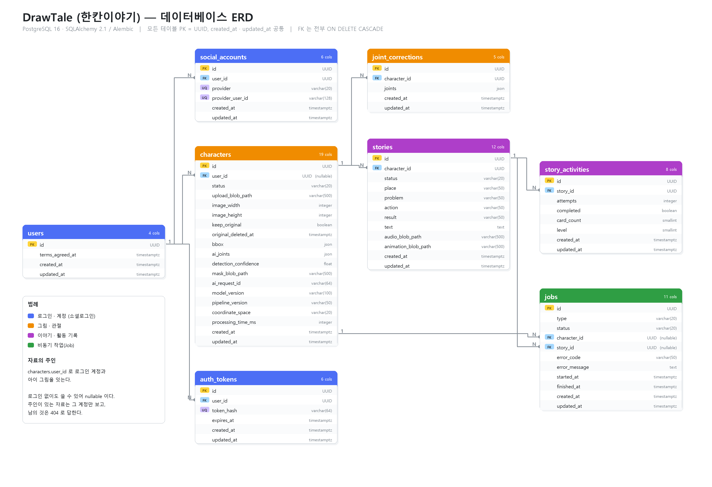

# 12. DB ERD

| 항목 | 내용 |
|---|---|
| 문서 버전 | v0.1 |
| 기준일 | 2026-10-12 |
| 기준 코드 | 백엔드 `dev` · 마이그레이션 `e1f2a3b4c5d6` |
| DB | PostgreSQL 16 (Azure Database for PostgreSQL) |



> **이 문서는 무엇인가**
>
> 서비스가 **무엇을 어디에 저장하는지** 적은 문서다.
> 표 8개가 있고, 크게 **로그인 쪽**과 **그림 · 이야기 쪽**으로 나뉜다.
> 저장 위치(파일이냐 DB냐)는 [01 6장](01-system-architecture.md)에,
> 언제까지 두는지는 [01 7-3](01-system-architecture.md)에 있다.

---

## 1. 모든 표에 공통인 것

| | |
|---|---|
| **기본 키** | `id` — UUID. 번호를 순서대로 매기지 않는다 |
| **시각** | `created_at` · `updated_at` — 시간대를 포함한다 |
| **연결** | 모든 외래 키에 **함께 지우기**(ON DELETE CASCADE) |

**번호 대신 UUID 를 쓴 이유**는 주소에 그대로 나오기 때문이다.
`/characters/1`, `/characters/2` 처럼 순서대로라면 **옆 번호를 넣어 남의 그림을 찾아볼 수 있다.**
UUID 는 그렇게 짐작할 수 없다. 다만 이것만으로 막지는 않고, 주인을 확인하는 검사를 따로 둔다
(아래 4장).

---

## 2. 표 여덟 개

### 로그인 쪽

| 표 | 무엇이 들어 있나 | 눈여겨볼 것 |
|---|---|---|
| **users** | 보호자 · 교사 계정 | **이름 · 이메일 · 사진을 저장하지 않는다.** 약관에 동의한 시각만 있다 |
| **social_accounts** | 어느 제공자의 누구인지 | `provider` + `provider_user_id` 조합이 유일하다. 한 사람이 카카오와 구글을 둘 다 이으면 두 줄이 된다 |
| **auth_tokens** | 로그인 상태 | **토큰 원문을 저장하지 않고** SHA-256 으로 바꿔 둔다. DB 가 새어도 로그인은 빼앗기지 않는다 |

`users` 에 아이에 관한 칸이 하나도 없다는 점이 이 설계의 핵심이다.
받지 않기로 한 것은 **저장할 자리 자체를 만들지 않았다.**

### 그림 쪽

| 표 | 무엇이 들어 있나 | 눈여겨볼 것 |
|---|---|---|
| **characters** | 올린 그림 하나와 그 분석 결과 | 19칸으로 가장 크다. 아래에서 따로 본다 |
| **joint_corrections** | 어른이 관절을 고친 기록 | **덮어쓰지 않고 쌓는다.** 가장 마지막 줄이 지금 관절이다 |

`joint_corrections` 를 쌓는 이유는 **되돌릴 수 있어야 하기 때문**이다.
덮어쓰면 "처음 자리로 되돌리기"(S-06)를 할 수 없다.

### 이야기 쪽

| 표 | 무엇이 들어 있나 | 눈여겨볼 것 |
|---|---|---|
| **stories** | 고른 네 칸과 만들어진 이야기 | `audio_blob_path` · `animation_blob_path` 는 **비어 있을 수 있다** (`02` 6-0) |
| **story_activities** | 순서 맞추기를 한 기록 | 같은 이야기를 다시 하면 줄이 하나 더 생긴다 |

### 작업 쪽

| 표 | 무엇이 들어 있나 | 눈여겨볼 것 |
|---|---|---|
| **jobs** | 오래 걸리는 일 하나 | `character_id` 와 `story_id` 가 **둘 다 비어 있을 수 있다.** 분석 작업은 앞의 것만, 이야기 작업은 둘 다 채운다 |

---

## 3. characters 를 자세히

가장 큰 표라 네 덩어리로 나눠 본다.

| 덩어리 | 칸 | 언제 채워지나 |
|---|---|---|
| **올린 것** | `upload_blob_path` `image_width` `image_height` | 그림을 올릴 때 |
| **주인과 설정** | `user_id` `keep_original` `original_deleted_at` | 올릴 때 · 원본을 지울 때 |
| **AI 가 찾은 것** | `bbox` `ai_joints` `detection_confidence` `mask_blob_path` `ai_request_id` | 분석이 끝날 때 |
| **어떻게 찾았는지** | `model_version` `pipeline_version` `coordinate_space` `processing_time_ms` | 분석이 끝날 때 |

마지막 덩어리가 왜 있냐면, **모델을 바꿔도 예전 결과가 어느 모델에서 나온 것인지 알아야 하기 때문**이다.
A2 가 포즈 모델을 바꾸면 `model_version` 이 달라지고, 그 전후를 비교할 수 있다 (F-CHR-08).

`upload_blob_path` 는 **원본을 지운 뒤에도 남긴다.** 어떤 경로에 있었는지는 기록으로 두고,
`original_deleted_at` 에 지운 때를 적는다. 그래야 "지웠다"와 "처음부터 없었다"를 가를 수 있다.

---

## 4. 자료의 주인

`characters.user_id` 가 **로그인 계정과 아이 그림을 잇는다.**

```
users ──1:N──▶ characters ──1:N──▶ stories ──1:N──▶ story_activities
                    └───1:N──▶ joint_corrections
```

| | |
|---|---|
| 로그인하고 올린 그림 | `user_id` 가 찍힌다. **그 계정만** 보고 고칠 수 있다 |
| 로그인하지 않고 올린 그림 | `user_id` 가 비어 있다. 주소를 아는 사람이 쓴다 |

**이야기와 작업에는 주인 칸이 따로 없다.** 그림을 따라가기 때문이다.
이야기의 주인이 누구인지 알려면 `stories → characters → user_id` 를 보면 된다.
주인을 두 군데 적으면 서로 어긋날 수 있어 한 곳에만 둔다.

남의 자료에는 **404(없음)** 로 답한다. 403(권한 없음)은 「그 자료가 있긴 하다」를 알려주는 셈이다.

---

## 5. 지울 때 함께 지워지는 것

| 지우면 | 함께 지워진다 |
|---|---|
| 계정 | 그 계정의 소셜 연결 · 로그인 값 · 그림 · 이야기 · 활동 기록 전부 |
| 그림 | 그 그림의 관절 보정 이력 · 이야기 · 작업 기록 |
| 이야기 | 그 이야기의 활동 기록 · 작업 기록 |

**계정을 지우면 아무것도 남지 않는다.** 탈퇴했는데 그림이 남아 있으면 안 되기 때문이다.

가운데 줄(그림을 지우면 이야기까지)은 **아직 쓰이지 않는다.**
지금은 캐릭터를 지우는 길이 없고, 「원본 그림 지우기」(F-SET-04)는
**파일만 지우고 표의 줄은 남긴다.** 캐릭터를 지우는 기능을 만들 때 다시 본다
([01 6장](01-system-architecture.md)).

---

## 6. 파일은 DB 에 넣지 않는다

그림 · 음성 · 영상은 **저장소(Blob)에 두고, DB 에는 경로만** 적는다.

| 칸 | 가리키는 것 |
|---|---|
| `characters.upload_blob_path` | `uploads/{character_id}.png` |
| `characters.mask_blob_path` | 움직일 영역만 남긴 흑백 이미지 |
| `stories.audio_blob_path` | `results/{story_id}.mp3` |
| `stories.animation_blob_path` | `results/{story_id}.mp4` |

파일을 DB 에 넣으면 **백업과 조회가 다 무거워진다.** 그리고 저장소를 바꿀 때
(로컬 → Blob) DB 를 건드리지 않아도 된다. 실제로 그렇게 바꿨고, 경로 모양은 그대로였다.

---

## 7. 표 구조를 바꿀 때

표를 손으로 고치지 않는다. **Alembic 마이그레이션 코드로만** 바꾼다.

```
모델(app/models) 수정
  → alembic revision --autogenerate
  → 만들어진 파일 확인 (의도하지 않은 변경이 없는지)
  → alembic upgrade head
```

공유 DB 를 쓰므로 **올리기 전에 팀에 알린다.** 칸을 더하는 것은 대체로 안전하지만,
칸을 지우거나 이름을 바꾸면 다른 사람의 코드가 깨진다.

| 지금까지 | |
|---|---|
| 마이그레이션 | 7개 |
| 마지막 | `e1f2a3b4c5d6` — characters 에 user_id 추가 (2026-10-12) |

---

## 8. 아직 정하지 않은 것

| 무엇 | 지금 |
|---|---|
| 언제까지 두나 | 원본 그림(24시간)과 로그인 값(30일)만 정해져 있다. 나머지는 초안 ([01 7-3](01-system-architecture.md)) |
| 비회원 자료를 계정에 붙일지 | 비회원으로 만든 것은 주인이 없다. 로그인할 때 이을지 정하지 않았다 |
| 그림을 지우면 이야기도 지울지 | 5장 참고 |

ERD 그림은 `tools/` 의 스크립트로 만든다. 표가 바뀌면 그림도 다시 만들어 함께 올린다.
