# 14. 확장 설계 초안 — 사람 모양이 아닌 그림은 어떻게 할까

| 항목 | 내용 |
|---|---|
| 문서 버전 | v0.2 (초안) |
| 기준일 | 2026-10-19 |
| 성격 | 네 발은 **2026-10-20 에 시험해 봤습니다**(12장). B 등급은 아직 초안입니다 |
| ⚠ 바뀐 것 | **2026-10-27 에 방침이 바뀌었습니다.** 뱀 · 문어 같은 그림도 **관절을 움직입니다.** 10-20 에 「리깅 없이 연출로」 정한 것(10장)은 취소됐고, 연출은 보조로 내려갔습니다. 범위는 [15 비휴머노이드 골격](15-비휴머노이드-골격.md)에 따로 적었습니다 |

## 이 문서를 쓴 이유

「강아지를 그리면 어떻게 되나요」, 「뱀은요」, 「거미나 지네는요」 같은 질문을 여러 번 받았습니다.
처음에는 사례마다 답했는데, 답할 때마다 다음 형태가 나와서 끝이 없었습니다.

그래서 사례 대신 **범위를 넓히려면 설계가 어떻게 달라지는지**를 한 번 정리해 두기로 했습니다.
결론만 먼저 적으면, 관절을 박아 움직이는 방식(**리깅**)으로 모든 형태를 덮는 것은 가능하지 않고,
그 바깥은 **관절 없이 그림을 다루는 표현**으로 가는 편이 낫다고 봅니다.
이 문서는 그 판단의 근거와, 하려면 어떤 순서로 하겠다는 계획입니다.

---

## 1. 리깅이 어디서 막히는지, 저희가 겪은 것부터

처음 애니메이션을 붙였을 때 가장 애먹은 것은 동물이 아니라 **사람 그림**이었습니다.
아이들은 팔을 몸통에 딱 붙여 그리는 경우가 많은데, 그 상태에서 팔을 크게 휘두르는 동작을 입히면
팔과 몸통이 한 덩어리로 뭉개졌습니다. 그래서 팔 회전을 줄인 순화 동작(`_gentle`)을 따로 만들어 쓰고 있습니다.

여기서 배운 것이 있습니다. 리깅은 **관절 위치뿐 아니라 그림의 모양에도 민감합니다.**
관절을 정확히 찍어도 그림이 그 움직임을 버티지 못하면 결과가 깨집니다.

사지가 늘어나면 이 문제에 두 가지가 더 붙습니다.

거미처럼 다리가 여덟 개면, 먼저 **어느 덩어리가 몇 번째 다리인지** 가려내야 합니다.
저희가 쓸 수 있는 방법은 움직일 영역만 남긴 흑백 그림(**마스크**)에서 중심선을 뽑아
가지 끝을 찾는 것인데, 다리가 몸통 주변에 촘촘히 붙어 있으면 가지가 서로 엉켜서 몇 개인지조차 불안정합니다.
그 다음은 **걸음의 순서**입니다. 다리 여덟 개가 동시에 움직이면 벌레처럼 보이지 않습니다.
실제 거미는 정해진 순서로 다리를 들어 올리는데, 그 순서를 사람이 정해 넣어야 합니다.
지네처럼 다리가 수십 개가 되면 이 작업 자체가 성립하지 않습니다.

마지막은 동작 데이터입니다. 저희가 쓰는 동작 파일(**BVH**, 관절마다 각도를 프레임 단위로 적어 둔 텍스트 파일)은
사람 골격 이름으로 적혀 있습니다. 네 발 동물은 Meta 가 준 설정 파일이 사람 다리 하나를 앞다리와 뒷다리에
겹쳐 쓰도록 적어 둬서 사람 동작을 그대로 쓸 수 있지만, 거미나 지네에 쓸 수 있는 동작 데이터는 없고
모션 캡처를 구할 데도 없습니다. 계산으로 만들 수는 있는데 **다리 개수마다 다시 만들어야** 합니다.

집이나 자동차, 구름처럼 아이들이 자주 그리는 사물에는 애초에 리깅할 관절이 없습니다.

---

## 2. 생각을 뒤집게 된 지점

이야기 장면을 설계하다가 「숨었어요」에서 막혔습니다.
2D 그림으로는 숨는 동작을 만들 수가 없습니다. 웅크려도 뒤에 숨을 것이 없고,
앞뒤로 움직이는 것은 평면에서 눌려 사라집니다.

그래서 동작을 포기하고 **아이 그림이 천천히 사라지고 배경만 남는 방식**으로 바꿨습니다.
만들어 보니 오히려 뜻이 더 분명했고, 서버에서 영상을 만들 필요도 없었습니다.

이때 알게 된 것이 이 문서의 출발점입니다.
**행동을 반드시 관절 움직임으로 표현할 필요가 없습니다.**
화면 안에서 움직이거나, 커졌다 작아지거나, 사라지거나, 효과음을 내는 것으로도 전달됩니다.
2D 애니메이션과 만화가 원래 쓰는 방법이기도 합니다.

리깅이 막히는 형태는, 리깅을 더 밀어붙이기보다 이쪽으로 가는 편이 맞다고 생각하게 됐습니다.

---

## 3. 등급을 셋으로 나누는 안

지금 설계는 사람 모양으로 알아보지 못하면 그림을 돌려보냅니다.
대신 **알아본 정도에 따라 처리를 나누면** 돌려보내는 일 없이 무엇을 그려도 뭔가는 움직입니다.

처음에는 B 를 「뱀이나 문어처럼 튀어나온 끝이 몇 개 보이는 그림」으로 잡았는데,
**2026-10-20 시험을 하고 나서 네 발로 바꿨습니다.** 네 발은 골격도 동작도 이미 있어서
관절만 찍으면 A 와 비슷한 품질로 걷는 것을 확인했기 때문입니다.
반대로 뱀이나 문어는 아직 아무것도 없어서 C 로 내렸습니다.

> **2026-10-27 에 넷으로 늘었습니다.** 아래 표는 그 뒤 모습입니다.
> 옛 C(연출)가 **D 로 내려가고**, 비휴머노이드가 **C** 로 올라왔습니다.
> C 의 범위와 근거는 [15 비휴머노이드 골격](15-비휴머노이드-골격.md)에 있습니다.

| | A | B | **C** | D |
|---|---|---|---|---|
| 어떤 그림 | 사람 · 곰 · 로봇처럼 **두 발로 선** 그림 | **네 발 동물 — 옆모습** | **뱀 · 물고기 · 나비 · 문어 · 곤충** | 집 · 구름 · 지네, **그 밖** |
| 골격 | 사람 15관절 | **네 발 16관절** (Meta 제공) | **우리가 정의합니다** (6~19관절) | 없음 |
| 관절을 누가 찍나 | **AI 가 자동으로** | **어른이 손으로** (15번 클릭) | **어른이 손으로** (6~19번) | 찍지 않음 |
| 움직임 | 사람 모션 캡처 | **사람 모션 캡처를 변환** | **계산으로 만든 동작** (사인파) | 연출 (이동 · 변형 · 효과) |
| 품질 | 지금 수준 | **거의 같음** (시험으로 확인) | **모릅니다 — 시험 전** | 거침 |
| 상태 | **구현돼 있습니다** | **시험 완료. 구현 전** | **범위만 정함** (15) | 보조로 내려감 |

**A 와 B 의 차이는 품질이 아니라 「관절을 누가 찍느냐」입니다.**
그래서 B 를 여는 일은 모델을 만드는 일이 아니라 **보정 화면을 넓히는 일**입니다.
**C 도 같습니다** — 골격과 동작은 생성기가 만들고, 사람이 하는 일은 점을 찍는 화면과
카드 매핑표입니다([15 7장](15-비휴머노이드-골격.md)).

D 가 바닥을 받칩니다. 아이가 무엇을 그려도 최소한 D 는 됩니다.
한 줄로 적으면 **「아이 그림은 무엇이든 움직입니다. 사람 · 네 발 · 뱀 쪽이면 관절이 움직입니다」** 가 됩니다.

## 4. D — 관절 없이 그림을 다루는 쪽 (2026-10-27 전까지 C 였습니다)

> 이 장은 **D 등급** 이야기입니다. 아래의 「C」는 모두 **D** 로 읽으십시오.
> 10-27 에 비휴머노이드가 C 로 올라오면서 번호가 한 칸 밀렸습니다.
> **여기 적은 연출 수단은 버리지 않습니다** — D 등급 그림과,
> 관절로 표현할 수 없는 행동 카드(「숨었어요」 · 「크게 불렀어요」)에 그대로 쓰입니다.
> 그 카드들은 **사람 그림에도 연출이 필요합니다**([15 6장](15-비휴머노이드-골격.md)).

C 는 그림을 변형하지 않고 **다룹니다.** 종이 인형을 손으로 움직이는 것에 가깝습니다.
화면 안에서 좌우로 움직이고, 기울이고, 커졌다 작아지고, 흔들고, 사라지거나 나타나고,
주변에 효과선이나 반짝임을 그리고, 효과음을 냅니다.

이것만으로 행동 카드를 구분할 수 있을지가 관건입니다. 지금 생각하는 방식은 이렇습니다.

「달려갔어요」는 그림이 빠르게 좌우로 지나가면서 뒤에 효과선이 남습니다.
「크게 불렀어요」는 그림이 한 번 커졌다 돌아오고 물결이 퍼져 나갑니다.
「물어봤어요」는 몸을 조금 기울이고 말풍선을 띄웁니다.
「기다렸어요」는 거의 움직이지 않고 아주 작게 흔들립니다.
「숨었어요」는 이미 정한 대로 사라집니다.

관절이 움직여서 구분되는 것이 아니라, **연출로 구분됩니다.**
그래서 C 를 「애니메이션」이라고 부르기는 어렵고 「연출」에 가깝습니다. 이 점은 숨기지 않는 편이 낫다고 봅니다.

의외인 것은 **C 가 가장 싸다**는 점입니다.
AI 도 서버 렌더링도 필요 없고 화면 쪽에서 그림 한 장을 다루면 됩니다.
브라우저에서 캐릭터를 움직여 보여 주는 코드와 「숨었어요」 효과가 이미 그 방향이라, 시험판은 1~2주면 될 것으로 봅니다.

---

## 5. B — 네 발 동물

**골격과 동작은 이미 있습니다.** Meta 가 네 발 골격(16관절)과,
사람 동작을 그 골격에 먹이는 설정을 함께 줍니다.
그래서 동물용 모션 캡처를 따로 구할 필요가 없습니다 — 사람 걷기 하나로 네 발이 걷습니다.

빠진 것은 **관절을 찍는 일 하나**입니다. 관절을 찾는 모델이 사람 전용이라
동물 관절은 찍어 주지 않습니다. 그래서 어른이 화면에서 찍는 방식이 됩니다.

실제로 돌려 보고 품질을 확인했습니다 — 12장에 결과와 영상이 있습니다.
받는 조건은 **정측면, 네 다리가 보이게, 기울어진 각도는 제외**입니다.

> **접었던 안이 10-27 에 돌아왔습니다.** 처음에는 B 를 「마스크에서 중심선을 뽑아
> 가지 끝을 손잡이로 쓰고, 형태와 무관한 규칙으로 움직이는」 방식으로 잡았습니다.
> 뱀이나 문어를 염두에 둔 것이었는데 10-20 회의에서 범위에서 뺐습니다.
>
> 지금은 **C 등급으로 돌아왔습니다.** 다만 중심선을 자동으로 뽑는 방식이 아니라
> **어른이 점을 찍고, 동작은 계산으로 만드는** 방식입니다
> ([15 비휴머노이드 골격](15-비휴머노이드-골격.md)).

## 6. 어떤 등급으로 갈지 정하는 순서

위에서부터 내려갑니다. 되는 데서 멈춥니다.

```
① 사람 모양으로 검출되고 관절 점수가 충분한가        →  A
② (방향을 돌려 봐도 안 되면) 네 발로 보이나          →  B  어른이 관절을 찍는다
③ 그 밖                                            →  C
```

②의 「방향을 돌려 본다」는 누운 그림과 옆으로 찍힌 사진 때문에 이미 설계해 둔 단계입니다
([06 3-4](06-input-guideline.md)).

**②를 자동으로 판별하는 방법은 아직 없습니다.** 가로세로 비율이나 아래로 뻗은 덩어리 수로
짐작할 수는 있지만 재 보지 않았습니다. 당분간은 **어른이 「네 발이에요」를 고르는 쪽**이
현실적입니다 — 어차피 관절도 어른이 찍어야 합니다.

아이에게는 등급을 보여 주지 않습니다. 화면에는 결과만 나옵니다.

## 7. 이 설계가 지금 문제도 건드립니다

확장과 별개로, 지금 사람형에서도 같은 병이 있습니다.
행동 카드 여섯 장 중 「물어봤어요」, 「도와줬어요」, 「크게 불렀어요」가 **모두 손 흔들기 하나**로 나옵니다(`C-04b`).
Mixamo 에서 걷기와 뛰기를 받아도 이 셋은 그대로 겹칩니다.

동작을 더 받는 것으로는 끝이 없습니다. 「물어봤어요」에 맞는 동작을 받아도
「크게 불렀어요」와 「도와줬어요」가 또 남습니다.
그런데 C 의 표현 수단을 쓰면 말풍선, 퍼지는 물결, 다가가기로 셋을 가를 수 있습니다.

그래서 C 의 표현 수단은 동물을 위한 것이라기보다 **지금 저희 문제를 푸는 도구**입니다.
형태를 넓히는 일은 그 도구가 생긴 다음에 따라오는 쪽이 자연스럽습니다.

---

## 8. 비용과, 이번에 하지 않는 이유

| 할 일 | 어디 | 예상 |
|---|---|---|
| C 표현 수단 만들기 | 프론트 | 1~2주 |
| 행동 카드 24장을 등급별로 어떻게 보여 줄지 정하기 | 기획 | 1주 |
| B 손잡이 추출과 규칙 | AI | 2~4주 |
| **아이가 실제로 구분하는지 확인** | 기획 | 가장 오래 |

마지막 줄이 제일 중요하고 제일 불확실합니다.
말풍선과 효과선으로 「물어봤어요」와 「크게 불렀어요」를 갈라 놓아도,
아이가 그 차이를 알아차리지 못하면 위의 작업은 의미가 없습니다.
이건 만들어서 보여 주고 물어봐야 알 수 있습니다.

이번 범위에서 빼기로 한 이유는 간단합니다.
A 등급을 그림 올리기부터 영상까지 사람 손 없이 이어지게 만드는 일이 아직 끝나지 않았습니다.
관절이 어긋나 어른이 고쳐야 하는 경우가 남아 있고, 행동 카드와 동작이 겹치는 문제도 그대로입니다.
여기서 품질이 확보되지 않은 채 등급을 늘리면 **거친 결과가 세 종류로 늘어나는 것**에 가깝다고 봤습니다.

---

## 9. 아직 모르는 것

가장 큰 것은 **거칠어도 보여 주는 편이 나은가**입니다.
지금은 사람 모양이 아니면 「두 발로 선 친구를 그려 볼까요」라고 안내하고 돌려보냅니다.
D 등급을 넣으면 돌려보내지 않지만, 아이가 그린 강아지가 종이 인형처럼 좌우로 흔들리는 것을 보게 됩니다.
어느 쪽이 아이에게 나은지 저희는 모릅니다. 현장에 물어볼 항목으로 넣어 두었습니다([07 4-9](07-user-research.md)).

그 밖에 정하지 못한 것은 이렇습니다.
효과를 넣다 보면 아이 그림보다 효과가 눈에 띌 수 있는데, 배경 그림에서 이미 조심하던 문제가 여기서 더 커집니다.
B 나 C 등급에서 그림이 얼마나 뭉개지면 D 로 내릴지도 기준이 없습니다.
등급을 보호자에게는 알릴지도 정하지 않았습니다.

---

## 10. 2026-10-20 회의에서 정한 것

교수님께서 네 발 보행과 그 밖의 다양한 낙서(문어 · 뱀 · 새 · 외계인 등)를 여러 번 물으셔서,
팀에서 한 번에 정리했습니다. 두 갈래로 나눠 처리하기로 했습니다.

### 다양한 낙서는 리깅 없이 표현합니다 (C 등급 채택)

> **⚠ 이 결정은 2026-10-27 에 취소됐습니다.** 비휴머노이드도 **관절을 움직입니다.**
> 아래는 10-20 회의에서 정한 내용의 기록으로 남겨 둡니다.
> 무엇이 바뀌었고 왜 바뀌었는지는 [15 비휴머노이드 골격 1장](15-비휴머노이드-골격.md)에 있습니다.
> 여기 적은 연출 셋(사라지기 · 위아래 · 좌우)은 **D 등급과 일부 행동 카드에 그대로 씁니다.**

문어 · 뱀 · 새 · 외계인처럼 사람 골격에 맞지 않는 그림은 **관절을 박아 움직이는 방식을 쓰지 않습니다.**
대신 아래 세 가지로 표현합니다.

- **사라졌다 나타나기**
- **위아래로 흔들리기**
- **좌우로 흔들리기**

4장에 적어 둔 표현 수단 중에서 **먼저 만들 세 가지**를 고른 것입니다.
효과선이나 말풍선 같은 것은 나중에 보태고, 우선 이 셋으로 행동 카드를 구분해 봅니다.

이렇게 정한 이유는 1장에 적은 그대로입니다. 리깅은 사지 개수가 늘면 무너지고,
뱀이나 지네에 쓸 동작 데이터도 없습니다. 그런데 **움직이기는 해야** 돌려보내지 않을 수 있어서,
리깅이 아닌 쪽으로 바닥을 받치기로 했습니다.

### 네 발 보행은 시험해 봅니다

교수님 말씀대로 **네 발은 기술적으로 가능해 보입니다.** Meta 가 네 발 골격(`four_legs`, 16관절)과
그 골격에 사람 동작을 입히는 설정을 이미 주고, 예제도 들어 있습니다.
그래서 이번 주에 실제로 돌려 보고 결과를 보고 판단하기로 했습니다.

다만 **받는 그림의 조건을 아주 좁게** 잡습니다.

- **옆모습이어야 합니다.** 네 다리가 모두 보이는 정측면
- **얼굴은 정면을 봐도 됩니다** (아이들이 이렇게 그리는 경우가 많습니다)
- **기울어지거나 회전된 각도로 올린 그림은 전부 제외합니다.** 돌려서 맞추지 않습니다

이 조건에서 걷기와 달리기가 **일부라도 쓸 만하게 나오는지**가 이번 시험의 질문입니다.

### 실패해도 산출물로 씁니다

시험이 잘 안 되면 그 결과를 발표 자료에 넣습니다.
어느 자리에서 어떻게 깨지는지 보여 주는 영상이나 캡처가, 말로 하는 설명보다 분명합니다.
그래서 **성공하든 실패하든 결과 영상과 캡처를 남기는 것**을 이번 시험의 산출물로 둡니다.

시험에 쓴 설정 파일과 결과물은 **아직 저장소에 올리지 않습니다.**
쓸 만한지 판단한 뒤에 정리해서 넣습니다.

---

## 11. 네 발 걷기 시험 계획

### 무엇이 이미 있나

| 필요한 것 | 상태 |
|---|---|
| 네 발 골격 설정 (`four_legs.yaml`) | 저장소에 있습니다 |
| 네 발 예제 캐릭터 (돼지. 그림 · 마스크 · 16관절) | 저장소에 있습니다 |
| 사람 걷기 동작 | `zombie.bvh` 가 **느릿한 걸음**이라 걷기 시험에 쓸 수 있습니다 |
| 달리기 동작 | **없습니다.** Mixamo 에서 받아야 합니다 |
| 렌더 코드 | Meta 코드를 그대로 씁니다. **우리 API 로는 안 됩니다** (15관절 고정) |

마지막 줄이 중요합니다. 우리 AI 서버의 렌더 호출은 관절 15개가 다 있어야 통과하도록 돼 있어서,
이번 시험은 **Meta 코드를 직접 호출하는 방식**으로 합니다. 우리 코드를 고치는 것은 그 뒤입니다.

### 세 단계로 나눠서 합니다

**① 기준선 — Meta 예제를 그대로 돌립니다 (30분)**

돼지 그림에 `zombie` 동작을 입혀 영상이 나오는지 봅니다.
여기서 실패하면 우리 그림 문제가 아니라 환경 문제라는 뜻이라, **원인을 가르는 기준**이 됩니다.

**② 우리 그림으로 (반나절)**

아이가 그린 느낌의 측면 강아지 한 장을 준비해서, 마스크를 만들고 16관절 좌표를 손으로 찍습니다.
AI 가 찍어 주지 않으니 사람이 넣습니다 — 이번 시험의 목적은 **자동화가 아니라 움직임 품질**입니다.

**③ 판정 (한 시간)**

무엇을 보고 쓸 만하다고 할지 **미리 정해 둡니다.** 안 그러면 「그럴듯하다 / 어색하다」로 끝납니다.

| 볼 것 | 왜 |
|---|---|
| 네 다리가 **각각** 움직이나 | 한 덩어리로 움직이면 걷는 것으로 안 보입니다 |
| 앞다리와 뒷다리가 **같은 박자**인가 | 설정이 사람 다리 하나를 둘에 겹쳐 쓰므로 그럴 것으로 예상합니다. 얼마나 어색한지가 문제입니다 |
| 몸통이 **위아래로 과하게** 흔들리나 | 사람 몸통(수직) 움직임을 수평 몸통에 넣기 때문입니다 |
| 그림이 **찢어지거나 뭉개지나** | 다리가 몸통에 붙어 있으면 생기는 문제입니다 |
| 얼굴이 정면인데 **목이 비틀리나** | 목 관절이 엉덩이에서 목 방향으로 매핑돼 있습니다 |

### 결과를 어떻게 남기나

- 성공이든 실패든 **MP4 와 프레임 캡처**를 남깁니다
- 깨지는 자리는 **그 프레임을 집어서** 캡처합니다
- 판정 표의 다섯 항목에 각각 한 줄로 적습니다

시험 파일은 저장소 밖(`drawtale/quadruped-test/`)에 둡니다. 판단이 끝난 뒤에 정리해 넣습니다.

---

## 12. 네 발 걷기 시험 결과 (2026-10-20)

계획대로 돌려 봤습니다. **걷습니다.** 예상이 몇 군데 틀렸고, 대신 다른 한계가 나왔습니다.

### 기준선 — Meta 예제

먼저 Meta 가 함께 주는 네 발 예제(돼지)에 사람 걸음 동작을 입혀 봤습니다.
779 프레임을 24초에 그렸습니다. 우리 AI 런타임 컨테이너에서 그대로 돌아갑니다.

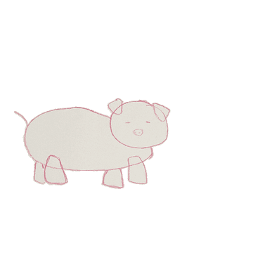

여기서 하나 알게 됐습니다. **캐릭터가 화면 밖으로 걸어 나갑니다.**
쓴 동작이 제자리 걸음이 아니라 앞으로 나아가는 동작이라 그렇습니다.
Mixamo 에서 받을 때 「In Place」를 켜야 한다고 적어 뒀는데([08 기술 스택](08-tech-stack.md)),
왜 켜야 하는지가 이걸로 분명해졌습니다.

### 우리 그림으로

팀원이 직접 그린 강아지와 공룡으로 했습니다.
**두 그림 모두 다리를 따로 떼어 그리지 않았습니다** — 강아지는 네 다리가 몸통에서 그대로 뻗어 나오고,
공룡은 조금 더 구분되는 정도입니다. 아이 그림에 가까운 조건입니다.

관절 16개는 **사람이 좌표를 읽어 넣었습니다.** 한 마리에 10분쯤 걸렸습니다.
AI 가 동물 관절을 찍어 주지 않으니 이번 시험은 그렇게 했습니다.

| 강아지 | 공룡 |
|---|---|
| 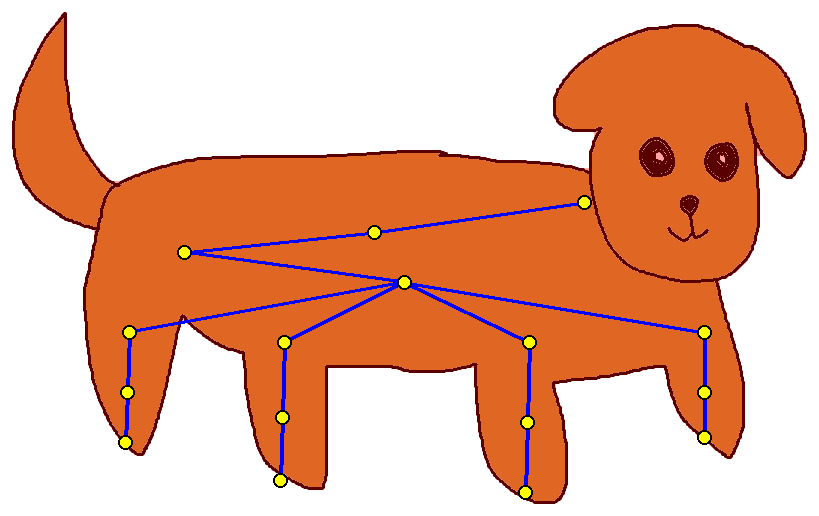 | 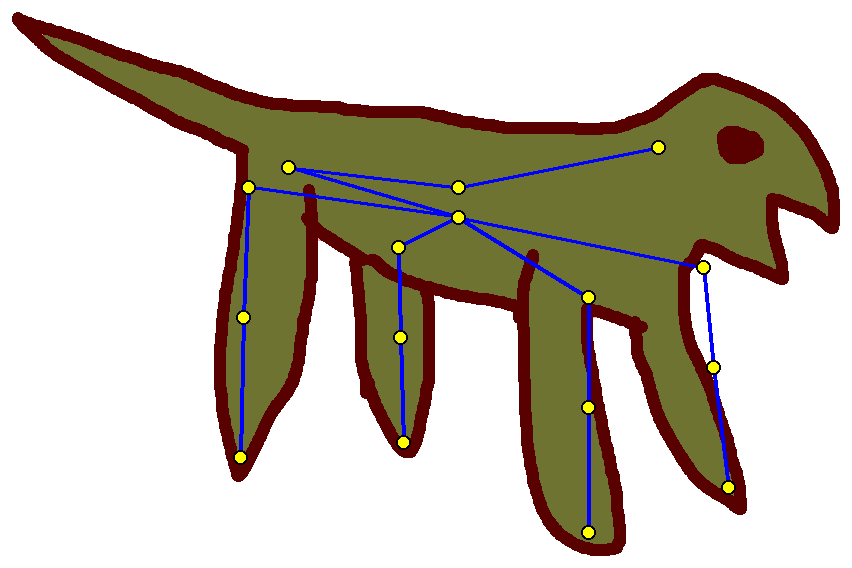 |

빨간 부분이 마스크(움직일 영역), 노란 점이 관절, 파란 선이 뼈대입니다.
마스크는 흰 배경에서 밝기로 갈랐고 둘 다 깨끗하게 나왔습니다.
엉덩이에서 한 점으로 모이는 자리가 `root` 와 `hip` 입니다 — 겹쳐 두는 것이 규칙입니다(아래).

| 강아지 | 공룡 |
|---|---|
| 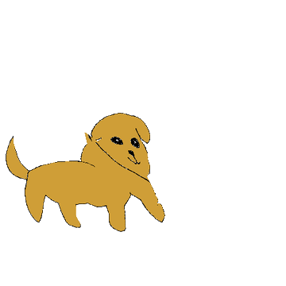 | 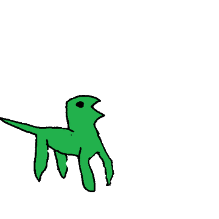 |

### 판정

계획에 미리 적어 둔 다섯 항목으로 봤습니다.

| 볼 것 | 강아지 | 공룡 |
|---|---|---|
| 다리 네 개가 각각 움직이나 | 움직입니다 | 움직입니다. 다리가 가늘어 더 잘 보입니다 |
| 앞뒤 발이 같은 박자인가 | **엇갈립니다** | **엇갈립니다** |
| 몸통이 과하게 흔들리나 | 적당합니다 | 적당합니다 |
| 그림이 찢어지나 | **안 찢어집니다** | **안 찢어집니다** |
| 목이 비틀리나 | 처음엔 말렸는데 **관절을 잘못 찍은 탓**이었습니다 (아래) | 괜찮습니다 |

**예상이 틀린 것이 둘, 저희가 틀린 것이 하나입니다.**

앞발과 뒷발이 같은 박자로 움직일 것이라고 봤습니다. 설정 파일에서 앞다리와 뒷다리가
사람 다리 하나를 같이 쓰는 줄 알았는데, 실제로는 **서로 다른 쪽 다리에 매핑**돼 있어
자연스럽게 엇갈립니다. 네 발 걸음으로 읽힙니다.

다리가 몸통에 붙어 있으면 찢어질 것이라고 봤는데 **안 찢어졌습니다.**
강아지가 바로 그 경우인데 멀쩡했습니다. 사람 그림에서 팔이 몸통에 붙으면 뭉개지던 것과 다릅니다.
다리가 아래로 뻗은 모양이라 변형 방향이 겹치지 않아서로 보입니다.

**처음에는 머리가 말리고 몸이 늘어나 보였는데, 저희가 관절을 잘못 찍은 것이었습니다.**

Meta 예제와 좌표를 비교해 보고 알았습니다. 두 군데가 규칙과 달랐습니다.

| | Meta 예제 | 처음 찍은 것 |
|---|---|---|
| `root` 와 `hip` 사이 거리 | **0** (같은 자리) | 222 |
| `torso` 에서 `neck` 까지 | 60 (짧음) | 212 (김) |

`root` 는 그림 전체를 들고 있는 손잡이라 **엉덩이에 겹쳐** 둡니다. 떼어 놓으면
없던 뼈가 하나 생겨서 걸을 때 몸통이 통째로 끌려다닙니다.
`torso` 는 **목 바로 밑**에 두는데 몸통 한가운데 찍었더니 목 뼈가 길어져 머리가 크게 휘둘렸습니다.

규칙대로 다시 찍으니 사라졌습니다. 왼쪽이 전, 오른쪽이 후입니다.

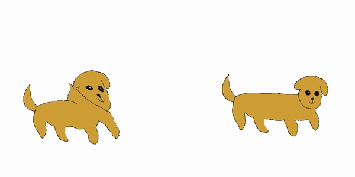

> **서비스 코드는 이미 이 규칙을 지키고 있었습니다.** AI 가 사람 관절 15개를 주면
> 렌더 직전에 `root` 를 엉덩이 자리에 자동으로 붙입니다. 네 발만 손으로 찍다 보니 틀린 것입니다.
> 그래서 시험 도구도 **`root` 를 묻지 않고 15개만 받도록** 고쳤습니다
> (`drawtale-ai/experiments/quadruped/`). 같은 실수가 아예 불가능해집니다.

**남는 한계는 둘입니다.**
**꼬리는 움직이지 않습니다** — 골격에 꼬리가 없습니다.
그리고 **옆모습만** 됩니다 — 기울어진 각도는 애초에 받지 않기로 했습니다.

### 좌우 방향은 신경 쓰지 않아도 됩니다

처음에는 Meta 예제를 따라 그림을 좌우로 뒤집어 오른쪽을 보게 했습니다.
확인해 보니 **뒤집지 않아도 똑같이 걷습니다.**

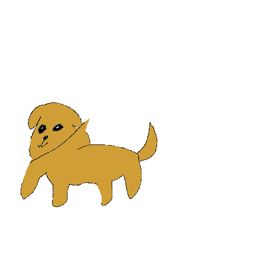

Meta 코드가 앞쪽을 그림에서 찾지 않고 **관절 좌표로 계산하기 때문**입니다.
그래서 서비스에서 아이나 보호자에게 **「어느 쪽을 보고 그렸나요」를 묻지 않아도 됩니다.**

다만 기울어진 그림은 다릅니다. 45도로 누운 그림은 관절을 찍어도 다리가 땅을 딛는 방향이 맞지 않습니다.
「정측면만」이라는 조건은 그대로 둡니다([06 R-12](06-input-guideline.md)).

### 그래서 남은 것

네 발 애니메이션 자체는 **된다는 것이 확인됐습니다.** 서비스에 넣으려면 둘이 남습니다.

하나는 **우리 렌더 코드가 관절 15개를 요구하는 것**입니다. 골격을 고를 수 있게 바꾸면 되고 반나절쯤입니다.

다른 하나가 진짜 문제입니다. **관절 16개를 누가 찍느냐.**
이번에는 사람이 좌표를 읽어 넣었고 한 마리에 10분 걸렸습니다.
서비스에서는 어른이 화면에서 끌어다 놓는 방식이 될 텐데, 사람 15관절용 보정 화면(S-06)을
16관절로 넓히는 일입니다. 다만 **어른 손이 많이 든다는 점은 그대로**라,
「아이가 스스로 끝까지 간다」는 원칙과 어긋나는 문제는 남습니다.

> 시험에 쓴 설정 파일과 원본 영상은 저장소 밖에 두었습니다.
> 여기에는 문서에 넣을 크기로 줄인 것만 올렸습니다.

---

## 13. 동작과 연출을 어떻게 나누나 (사람 · 네 발 공통)

걷기를 확인한 뒤 다른 동작도 걸어 봤습니다. **점프는 되는데 손 흔들기는 거의 아무 일도 일어나지 않습니다.**

네 발 대응표를 열어 보면 이유가 분명합니다. 사람의 **다리와 몸통만** 가져다 쓰고
**팔은 한 번도 쓰지 않습니다.** 네 발 동물에는 팔에 해당하는 부위가 없으니 당연합니다.
그래서 팔이 전부인 동작을 걸면 남는 것이 몸통 흔들림뿐이고, 화면에서는 거의 멈춰 보입니다.

### 그런데 사람도 사정이 좋지 않습니다

지금 사람 쪽은 행동 카드 여섯 장이 **동작 두 가지**로 뭉쳐 있습니다.
「달려갔어요」만 점프로 가고 나머지 다섯 장이 전부 손 흔들기입니다.
아이가 「도와줬어요」를 골라도 손을 흔듭니다.

**손 흔들기는 인사 동작입니다.** 「도와줬어요」나 「크게 불렀어요」에 붙일 동작이 아닌데,
남는 동작이라 붙여 둔 것입니다. 저희 문서에 이미 원칙이 있습니다 —
**확실하지 않으면 억지로 맞추지 않고 대기 동작을 씁니다. 틀린 동작이 나오는 것보다 낫습니다.**

### 규칙 하나로 통일합니다

> **그 행동에 분명히 맞는 동작이 있으면 쓰고, 없으면 대기 자세에 연출을 얹습니다.**

| 행동 카드 | 캐릭터 | 얹는 연출 |
|---|---|---|
| 달려갔어요 | **뛰기** | 효과선 |
| 기다렸어요 | **대기** | 아주 작게 흔들림 |
| 물어봤어요 | 대기 | **말풍선이 톡 나타남** |
| 크게 불렀어요 | 대기 | **물결이 퍼져 나감** + 조금 커졌다 돌아옴 |
| 도와줬어요 | 대기 | **다른 쪽으로 다가감** + 반짝임 |
| 숨었어요 | — | **사라졌다 나타나기** |

**사람과 네 발이 같은 표를 씁니다.** 차이는 「달려갔어요」를 두 발로 뛰느냐 네 발로 뛰느냐뿐입니다.
D 등급 그림도 「달려갔어요」만 이동으로 바꾸면 같은 표가 그대로 쓰입니다.

### 따라오는 것 둘

**손 흔들기를 쓸 카드가 없어집니다.** 행동 카드에 「인사했어요」가 없기 때문입니다.
결과 장면의 기뻐함이나 S-05 미리보기에만 남습니다.
카드를 손볼 때 **「인사했어요」를 넣을지** 같이 정하면 손 흔들기가 제자리를 찾습니다.

**크게 움직이는 카드가 「달려갔어요」 하나뿐입니다.** 나머지는 대기 자세입니다.
그래서 **움직임의 대부분을 연출이 담당하게 됩니다.**
연출을 제대로 만들지 않으면 여섯 장 중 다섯 장이 **가만히 서 있는 그림**이 됩니다.
이 점은 숨기지 않고 적어 둡니다.

### 받아 올 동작은 장면에 붙습니다

Mixamo 에서 받을 네 개는 행동 카드와 일대일이 아닙니다.

| 동작 | 어디에 쓰나 |
|---|---|
| 뛰기 | 「달려갔어요」 |
| **대기** | **기본값.** 장소 장면과 연출로 가는 카드 전부 |
| 좌절 | 문제 장면(②) |
| 걷기 | 장소 장면에서 걸어 들어오기 |

**대기가 가장 많이 쓰입니다.** 지금은 남는 동작처럼 보이지만 이 구조에서는 기본값이라,
어색하면 다섯 장이 한꺼번에 어색해집니다.

### 「달려갔어요」는 뛰기 동작을 받습니다

여섯 장 중 **크게 움직이는 유일한 카드**라 여기를 어떻게 하느냐가 영상 전체의 인상을 정합니다.
그래서 두 가지를 견줬습니다.

**걷기를 빠르게 돌려 봤습니다.** BVH 는 텍스트라 `Frame Time` 숫자 하나만 줄이면 빨라집니다
(순화 동작을 만들 때 쓴 방법과 같습니다). 2배속으로 돌리니 25초짜리가 15.6초가 됐습니다.

결과는 **「뛴다」까지는 아니었습니다.** 다리는 빨라지는데 **공중에 뜨는 순간이 없고
몸이 위아래로 튀지 않습니다.** 급한 걸음에 가깝습니다.

그래서 **뛰기 BVH 를 따로 받기로** 했습니다. Mixamo 에서 걷기를 받을 때 같이 받으면 되고,
대응표도 그대로 쓰므로 드는 일이 거의 없습니다.

**뛰기는 네 발에서도 됩니다.** 걷기와 점프가 된 것과 같은 이유로 **다리 동작**이기 때문입니다.
다만 사람 달리기에서 상체가 기울고 팔을 흔드는 부분은 네 발에 전달되지 않아,
전력 질주보다는 빠른 종종걸음에 가까울 것으로 봅니다.
**이 부분은 아직 재 보지 않았습니다** — 뛰기 BVH 를 받은 뒤에 확인합니다.

### 속도는 공짜로 바꿀 수 있습니다

받은 동작 하나로 여러 속도를 만들 수 있다는 것도 이번에 확인했습니다.
`Frame Time` 을 줄이면 빨라지고 키우면 느려지며, **렌더 시간은 그대로**입니다.

| 쓸 만한 자리 | |
|---|---|
| 지원 수준 1 | 느리게 보는 편이 나으면 0.7배속 |
| 「기다렸어요」 | 대기를 더 느리게 |
| 급한 느낌이 필요한 장면 | 걷기를 빠르게 |

동작을 하나 더 받는 것보다 싸므로, **동작이 모자랄 때 먼저 꺼내 볼 선택지**입니다.
다만 속도만으로는 성격이 바뀌지 않습니다 — 빠른 걷기가 달리기가 되지 않는 것처럼요.

### 연출은 화면이 그립니다

말풍선과 효과를 서버가 만드는 영상에 넣지 않습니다.

| | |
|---|---|
| 서버 | 대기 동작 영상 하나면 됩니다. **렌더가 늘지 않습니다** |
| 화면 | 그 위에 말풍선 · 물결 · 반짝임을 얹습니다 |
| 원칙 | 아이 그림에는 손대지 않습니다 — [12 6장](12-ai-architecture.md)과 같은 규칙입니다 |

영상에 구워 넣으면 「소리 전체 끄기」처럼 나중에 끄고 싶은 것을 끌 수 없고,
같은 영상을 다른 장면에 다시 쓰지도 못합니다.

**그리고 연출은 형태와 무관합니다.** 말풍선은 사람이든 강아지든 문어든 똑같습니다.
한 번 만들면 모든 등급에 쓰입니다. 그래서 **연출 수단을 먼저 만들고 그 다음에 네 발을 여는** 순서가 맞습니다.

---

## 14. CMU 동작 데이터를 붙여 봤습니다 (2026-10-20)

걷기는 Meta 가 준 동작으로 확인했지만 **뛰기는 가진 것이 없었습니다.**
Mixamo 가 BVH 를 주지 않는다는 것을 알고 나서 CMU Mocap 을 받아 걸어 봤고, **됐습니다.**

| 강아지 | 공룡 |
|---|---|
| 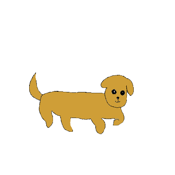 | 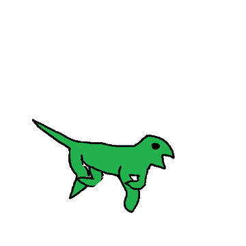 |

걷기와 분명히 다릅니다. **다리가 크게 엇갈리고 몸이 위아래로 튑니다.**
걷기를 2배속으로 돌렸을 때 나오지 않던 움직임이라, 뛰기 동작을 따로 받기로 한 판단이 맞았습니다.

### 어디서 받았나

[`una-dinosauria/cmu-mocap`](https://github.com/una-dinosauria/cmu-mocap) 에 BVH 가 그대로 올라와 있습니다.
전체를 받을 필요 없이 **파일 하나씩** 받으면 됩니다. 이번에 쓴 것은 `data/009/09_01.bvh`(달리기)입니다.

> **같은 CMU 인데 변환본이 여럿이라 주의해야 합니다.**
> 처음 받은 `cmuconvert-daz` 판은 뼈 이름이 `hip` · `rThigh` · `rShin` 식이고
> `Chest2` · `RightToe` 같은 관절이 아예 없어서 Meta 설정과 맞지 않았습니다.
> 위 저장소 판은 `Hips` · `LeftUpLeg` · `LeftLeg` · `LeftFoot` 라 **거의 그대로 맞습니다.**

### 손본 것 셋

**① 대응표에서 네 줄을 뺐습니다.** 받은 CMU 에 없는 뼈를 참조하는 줄입니다.

```
RightHandEnd · LeftHandEnd · Spine2 · Spine3
```

손끝과 몸통 투영에 쓰이는 것이라 네 발 결과에는 영향이 없었습니다.
117줄 중 네 줄이라 **대응표를 새로 쓸 필요가 없었습니다.**

**② 프레임을 솎아 냈습니다.** CMU 는 초당 120프레임으로 기록돼 있는데
우리 렌더는 30프레임쯤으로 뽑습니다. 그대로 쓰면 **4배 느리게** 보입니다.
네 프레임 중 하나만 남기니(149 → 38) 제 속도가 됐습니다.

**③ 아직 안 한 것 — 제자리로 만들기.** 받은 동작이 앞으로 나아가는 것이라
**캐릭터가 화면 밖으로 달려 나갑니다.** 걷기에서도 있던 문제인데 달리기는 더 빠릅니다.
뿌리 관절의 앞뒤 이동값을 0 으로 지우면 제자리가 되는데, BVH 숫자를 고치는 일이라 할 수 있습니다.

### 남은 문제 하나

**클립이 1.2초뿐입니다.** `09_01` 이 짧은 달리기라 그렇습니다.
이야기 장면은 몇 초는 돼야 하니 **더 긴 클립을 찾거나 이어 붙여 반복**해야 합니다.

### 그래서 기본 동작 여섯 가지가 이렇게 됩니다

| # | 동작 | 사람 | 네 발 |
|---|---|---|---|
| 1 | 걷기 | 받아야 함 | **확인됨** (Meta 동작으로 시험) |
| 2 | **뛰기** | 받아야 함 | **확인됨** (CMU) |
| 3 | 점프 | **있음** | **확인됨** |
| 4 | 대기 | 받아야 함 | 될 것으로 봄 |
| 5 | 손 흔들기 | **있음** | **안 됨** (팔 동작) |
| 6 | 좌절 | 받아야 함 | 될 것으로 봄 |

**받는 방법이 확인됐으니 남은 것은 걷기 · 대기 · 좌절 셋**입니다. CMU 에서 찾아 같은 절차로 넣으면 됩니다.
그리고 **5번은 네 발에서 영영 되지 않습니다** — 13장에 적은 대로 대기 자세에 연출을 얹어 채웁니다.

---

## 15. 사람 그림에도 걸어 봤습니다 (2026-10-20)

네 발만 확인했으니 **사람도 해 봐야** 했습니다. 이번에는 **실제 서비스 경로를 그대로 밟았습니다** —
관절은 AI 가 찾았고(15개), 캐릭터 준비도 서비스 코드(`prepare_character`)를 그대로 불렀습니다.
그래서 여기 나온 결과가 **지금 서비스에서 나올 결과와 같습니다.**

| 걷기 | 달리기 |
|---|---|
| 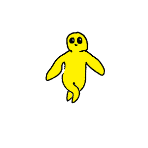 | 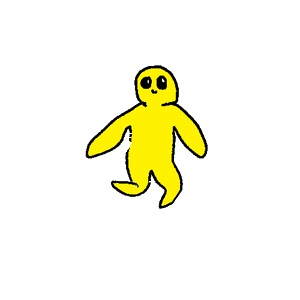 |

### 처음에는 팔이 뭉개졌습니다

그대로 걸었더니 **팔이 몸통에 눌려 사라지고 형체가 무너졌습니다.**
저희가 순화 동작(`_gentle`)을 만든 이유와 같은 문제입니다 —
아이 그림은 팔을 몸통에 붙여 그리는 경우가 많고, 팔을 크게 휘두르는 동작에서 뭉개집니다.

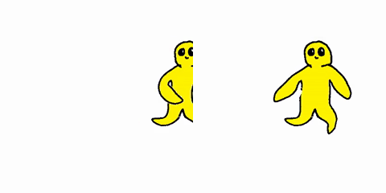

왼쪽이 그대로 건 것, 오른쪽이 순화한 것입니다.

**네 발에서는 이 문제가 없었습니다.** 네 발 대응표가 사람 팔을 아예 쓰지 않기 때문입니다.
13장에서 손 흔들기가 안 되던 것과 같은 이유가, 여기서는 **도움이 된 셈**입니다.

### 기존 순화 도구를 그대로 쓸 수 없었습니다

`make_gentle_motions.py` 는 **「기본 자세로 당기기」** 방식입니다.
Meta fair1 은 기본 자세가 T 자(팔을 옆으로 뻗은 모양)라 당기면 팔이 벌어지는데,
**CMU 는 다릅니다.** 그래서 CMU 용을 따로 만들었습니다.

| 하는 일 | 값 |
|---|---|
| 팔 움직임 줄이기 | **30% 만 남김** |
| 어깨를 **아래로** 돌리기 | **25도** |
| 팔꿈치 | 거의 펴 둠 (20%) |
| 수평 이동 줄이기 | **30% 만 남김** (위아래는 그대로) |

### 여기서 두 번 헤맸습니다

**① 뼈 이름이 변환본마다 다릅니다.** 처음 받은 `daz` 판은 `hip` · `rThigh` 식이었고
`Chest2` 같은 관절이 아예 없었습니다.

**② 기본 자세도 변환본마다 다릅니다.** 순화 도구 주석에는 「CMU 는 팔이 아래로」라고 적혀 있는데,
저희가 받은 변환본은 **T 자**였습니다. 그래서 「움직임을 줄이기」가 팔을 **수평으로 들어 올려**
만세하며 달리는 모양이 됐습니다. 각도를 더 벌리려던 처음 시도는 방향이 반대였고, **내려야** 했습니다.

> **같은 CMU 라도 변환본마다 뼈 이름과 기본 자세가 다릅니다.** 새 출처를 쓸 때 먼저 확인할 두 가지입니다.

### 다른 그림으로도 해 봤습니다

팔다리를 몸통에서 떼어 그린 그림으로 다시 돌렸더니 **훨씬 깨끗하게 나왔습니다.**

| 걷기 | 달리기 |
|---|---|
| 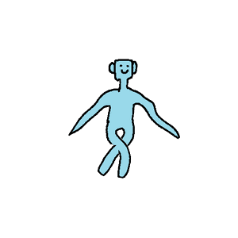 | 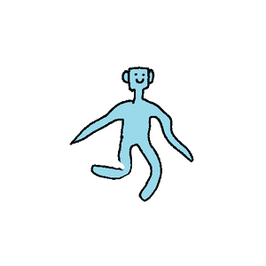 |

**AI 의 관절 인식은 두 그림 다 정확했습니다.** 차이는 그림 쪽에 있었고,
자세한 비교는 [06 3-5](06-input-guideline.md)에 두었습니다 — 입력 조건 `R-03` 의 근거가 됩니다.

### 각도는 그림마다 달라질 수 있습니다

0 · 25 · 40 · 55도를 돌려 보고 **25도**로 정했습니다. 0도는 만세, 55도는 다시 몸에 붙습니다.
다만 이 값은 **이 그림에 맞춘 것**입니다. 팔을 더 벌려 그린 아이면 덜 내려야 합니다.

나중에는 **그림에서 팔 각도를 재서 맞출 수 있습니다** — 어깨와 손목 좌표로 계산되고,
그 좌표는 AI 가 이미 주고 있습니다. 지금은 고정값으로 두고 여러 그림으로 시험한 뒤에 정합니다.

### 정리 — CMU 동작을 쓰려면 손볼 것 넷

| 손볼 것 | 사람 | 네 발 |
|---|---|---|
| 대응표 맞추기 | 뼈 이름 바꾸기 | 없는 뼈 참조 4줄 빼기 |
| 프레임 솎기 (120 → 30fps) | **필요** | **필요** |
| 팔 순화 (25도 내림 · 30% 유지) | **필요** | 불필요 |
| 수평 이동 줄이기 (30%) | **필요** | **필요** |

전부 **BVH 숫자를 고치는 일**이라 도구로 자동화됩니다. 지금은 시험용 스크립트로 해 두었고,
서비스에 넣을 때는 기존 `make_gentle_motions.py` 옆에 CMU 용을 두면 됩니다.

### 그래서 기본 동작 여섯 가지가 이렇게 됩니다

| # | 동작 | 사람 | 네 발 |
|---|---|---|---|
| 1 | **걷기** | **확인됨** (CMU) | **확인됨** |
| 2 | **뛰기** | **확인됨** (CMU) | **확인됨** (CMU) |
| 3 | 점프 | **있음** | **확인됨** |
| 4 | 대기 | 받아야 함 | 될 것으로 봄 |
| 5 | 손 흔들기 | **있음** | **안 됨** (팔 동작) |
| 6 | 좌절 | 받아야 함 | 될 것으로 봄 |

**남은 것은 대기와 좌절 둘**입니다. 받는 절차가 확인됐으니 CMU 에서 찾아 같은 방법으로 넣으면 됩니다.
