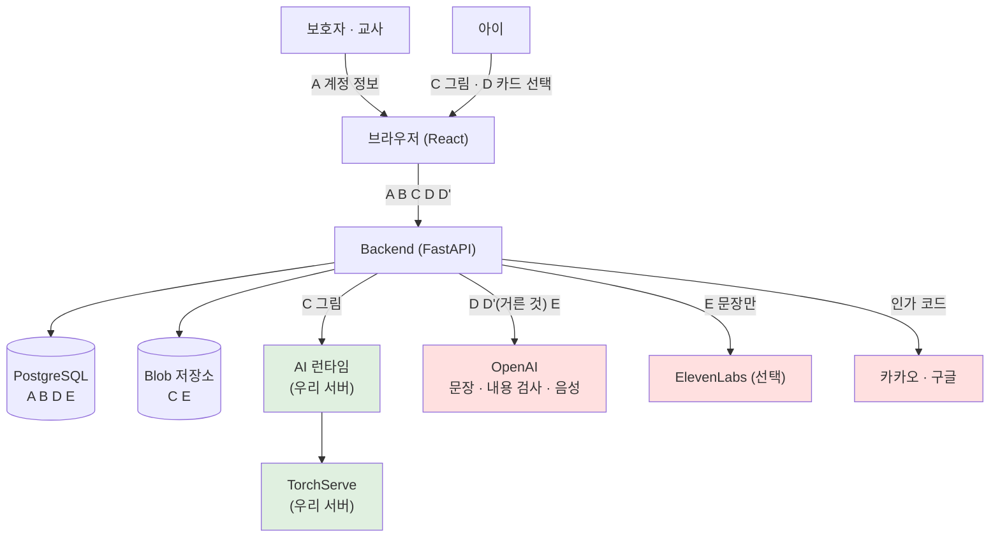

# 데이터 처리 지도

| 항목 | 내용 |
|---|---|
| 문서 버전 | v0.1 (초안) |
| 작성일 | 2026-10-12 |
| 근거 확인일 | 2026-10-12 |
| 기준 코드 | 백엔드 `dev` · 프론트 `feat/backend-contract` |

> **이 문서는 무엇인가**
>
> **어떤 자료가 어디로 움직이고, 무엇이 바깥으로 나가는지** 한 장으로 본 문서입니다.
> 왜 그렇게 정했는지는 [아동 개인정보와 AI 안전](아동-개인정보-AI안전.md)에 있습니다.

---

## 1. 자료를 여섯 등급으로 나눕니다

| 등급 | 무엇 | 개인정보인가 | 바깥으로 |
|---|---|---|---|
| **A** | 계정 정보 — 소셜 회원번호, 로그인 값 | **그렇습니다** | **보내지 않습니다** |
| **B** | 아이 프로필 — 별명, 난이도 설정, 만 14세 미만 여부 | **그렇습니다** | **보내지 않습니다** |
| **C** | 아이가 그린 그림 | 그럴 수 있습니다 | **보내지 않습니다** |
| **D** | 고른 카드 값 — `숲` `길을 잃었어요` | 아닙니다 | 보냅니다 |
| **D'** | **말로 덧붙인 내용** (카드 경로) · **말로 만든 이야기** (말하기 경로) | **알 수 없습니다** | **거른 뒤에만.** 기본 꺼짐이고 어른이 켜야 합니다 |
| **E** | 만들어진 이야기 · 음성 · 영상 | D 로 만든 것 | 문장만 보냅니다 (음성 생성) |
| **E'** | **아이가 지은 주인공 이름** | **그럴 수 있습니다** | **보냅니다. 아래 4-3 을 보십시오** |
| **F** | 서버 기록(로그) | 아닙니다 (아래 5장) | 보내지 않습니다 |

**C(그림)를 바깥으로 보내지 않는 것이 이 설계의 중심입니다.**
그림에는 아이 얼굴이나 이름이 들어 있을 수 있고, 사진과 그림을 가려내지도 못합니다
([06 입력 그림 요구사항](../06-input-guideline.md) 6-1).

---

## 2. 전체 흐름

빨간 상자가 **다른 회사 서버**입니다. 초록 상자는 우리가 띄운 서버입니다.

---

## 3. 화살표마다 무엇이 오가나

| 어디서 → 어디로 | 무엇 | 개인정보 | 저장되나 | 얼마나 |
|---|---|---|---|---|
| 아이 → 브라우저 | 그림, 카드 선택, 말한 내용 | C D D' | 브라우저에 잠깐 | 화면을 나가면 사라집니다 |
| 브라우저 → 백엔드 | 위 전부 + 로그인 값 | A C D D' | — | — |
| 백엔드 → DB | 계정 · 프로필 · 카드 선택 · 이야기 | A B D E | **예** | [02 7-3](../02-system-architecture.md) |
| 백엔드 → Blob | 그림 · 음성 · 영상 | C E | **예** | 원본 24시간, 나머지 미정 |
| 백엔드 → **AI 런타임** | 그림 파일, 관절 | C | AI 서버 작업 폴더 | 이야기를 만든 뒤 지웁니다 |
| 백엔드 → **OpenAI** | **카드 값 · 거른 덧붙임 · 만든 문장** | **D D' E** | OpenAI 쪽 정책 | 아래 4장 |
| 백엔드 → **ElevenLabs** | **쪽 단위 대본 · 인물 이름 · 감정 태그** | E E' | 업체 정책 | 아래 4-2 |
| 백엔드 → **카카오 · 구글** | 인가 코드 | — | — | — |

**아이에 관한 것(A B C)은 바깥으로 나가는 화살표에 하나도 없습니다.**

---

## 4. OpenAI 로 보내는 것

### 보내도 되는 것

| 무엇 | 예 |
|---|---|
| 고른 카드의 말 | `숲` `길을 잃었어요` `달려갔어요` `집에 갔어요` |
| 이야기 길이 · 난이도 설정 | 문장 수, 글자 수 상한 |
| 만들어진 문장 (내용 검사 · 음성용) | `오늘 나는 숲에 갔어요. …` |

### 보내면 안 되는 것

| 무엇 | 왜 |
|---|---|
| 아이 이름 · 별명 | 아이를 가리킵니다 |
| 보호자 이름 · 이메일 · 연락처 | 개인정보입니다 |
| 소셜 회원번호 · 로그인 값 | 계정을 가리킵니다 |
| **DB 의 id 값** (`character_id` 등) | 우리 쪽 자료와 이어집니다 |
| **아이가 그린 그림** | 얼굴 · 이름이 있을 수 있고, 이야기 문장을 만드는 데 필요하지 않습니다 |
| 만 14세 미만 여부 · 난이도 수준의 **근거** | 설정값만 보내고 그 이유는 보내지 않습니다 |

### 4-2. ElevenLabs 로 보내는 것

**읽어 주기를 ElevenLabs 로 바꿨습니다** (`TTS_PROVIDER=elevenlabs`, 모델 `eleven_v4`).
업체가 하나 늘었으므로 무엇이 가는지 다시 적습니다.

| 판 | 무엇을 보내나 |
|---|---|
| **나레이션 판** (기본) | 이야기 문장 전체 |
| **인물 목소리 판** | **쪽마다 누가 무슨 말을 하는지** — 말하는 사람 이름, 글, 감정 태그(`[happy]` 등) |

| | |
|---|---|
| 그림 · 관절 | **보내지 않습니다** |
| 계정 · 프로필 | **보내지 않습니다** |
| 아이 목소리 녹음 | **보내지 않습니다.** 말로 덧붙이기는 브라우저가 글자로 바꿉니다 |
| 긴 이야기 | 쪽이 **7~11개**라 짧은 이야기보다 보내는 글이 늘어납니다 |

### 4-3. 주인공 이름 — 아이 이름이 섞이지 않게 막아 둔 곳

인물 목소리 판에서는 주인공에게 이름을 붙입니다 (S-05N). 그 이름은 이야기를 만들 때
**OpenAI 로 가고**, **ElevenLabs 가 소리 내 읽습니다.** 그래서 이름을 받는 방법을 제한했습니다.

| 어떻게 짓나 | 실명이 섞일 수 있나 |
|---|---|
| **이름 카드에서 고르기** (기본) | **없습니다.** 토토 · 하루 · 콩이 · 별이 · 보리 · 솜이 여섯 개뿐입니다 |
| **말로 짓기** | **있습니다.** 아이가 자기 이름을 말할 수 있습니다. 그래서 **어른이 켜야만** 쓸 수 있습니다 (F-SET-06) |
| 이름 없이 넘기기 | 「나」로 쓰거나 AI 가 지어 줍니다 |

**자유 입력 칸은 두지 않았습니다.** 글자를 못 쓰는 아이를 위한 것이기도 하고,
실명이 들어갈 길을 막는 것이기도 합니다.

| 남은 것 | 상태 |
|---|---|
| 말로 지은 이름을 **그대로 저장합니다** (`stories.protagonist_name`) | 보관 기한을 정하지 않았습니다 |
| 말로 짓기를 켤 때 **무엇이 바깥으로 가는지 설명** | S-13 토글에 설명이 있습니다. 이름이 업체로 간다는 말은 없습니다 |

### 더 봐야 하는 것

| 무엇 | 왜 |
|---|---|
| **아이가 말로 덧붙인 내용** (D') | 무엇을 말할지 알 수 없습니다. **거른 뒤에만 보냅니다** |

> **[OpenAI 정책]** Under-18 API Guidance 는 **만 13세 미만 또는 해당 지역의
> 디지털 동의 연령 미만 아동의 개인정보**를 API 로 보내려면
> **Zero Data Retention 을 먼저 적용하라**고 안내합니다 (확인일 2026-10-12).
> 한국의 디지털 동의 연령은 만 14세입니다.
>
> **[DrawTale 설계 선택]** 그래서 **아이의 개인정보를 보내지 않는 쪽**을 기본으로 둡니다.
> ZDR 없이 아이 개인정보를 보내는 구조를 기본안으로 만들지 않습니다.
>
> **[법률 검토 필요]** 우리가 보내는 값이 실제로 개인정보에 해당하지 않는지,
> ZDR 적용이 필요한 범위가 어디까지인지 확인이 필요합니다.

### 말로 덧붙인 내용을 거르는 규칙

**[DrawTale 설계 선택]** 보내기 전에 아래를 찾아 지웁니다.

| 찾는 것 | 어떻게 |
|---|---|
| 전화번호 · 주민등록번호 모양 | 숫자 묶음 |
| 주소로 보이는 말 | `○○동` `○○아파트` `○○호` |
| 학교 이름 | `○○초등학교` `○○유치원` |
| 사람 이름으로 보이는 말 | 여기는 완전하지 않습니다 — 아래 |

**사람 이름을 완전히 걸러내기는 어렵습니다.** 그래서 두 가지를 함께 둡니다.

1. 걸러낸 뒤에도 남을 수 있다는 것을 **보호자 동의 화면에 적습니다**
2. **기본으로 꺼 두고 보호자가 프로필 설정에서 켜야만** 쓸 수 있게 합니다 (`F-SET-06`)
3. **말로 이야기를 만들 때는 어른이 대신 말합니다** (`F-STY-09`).
   아이가 혼자 말하는 것이 아니라, AI 가 묻고 어른이 아이에게 전한 뒤 대신 말합니다.
   **어른이 한 번 거르는 단계가 생깁니다**

---

## 5. 서버 기록(로그)

**아이가 만든 것은 기록에 남기지 않습니다** ([02 7-4](../02-system-architecture.md)).

| 남기지 않는다 | 남겨도 된다 |
|---|---|
| 그림 · 그림 내용 | 어느 자료인지 가리키는 번호 |
| 이야기 문장 · 아이가 말한 내용 | 작업 종류 · 상태 · 걸린 시간 |
| 로그인 값 · 소셜 회원번호 | 오류 코드 |
| 아이 별명 | 안전 검사 결과의 **분류 이름만** |

마지막 줄이 중요합니다. 내용 검사에 걸렸을 때 **무엇에 걸렸는지(분류)는 남기되,
걸린 글 자체는 남기지 않습니다.**

---

## 6. 아직 정하지 못한 것

| 무엇 | 상태 |
|---|---|
| 자료별 보관 기간 | 원본 그림 24시간 · 로그인 값 30일만 정해짐. 나머지는 초안 |
| 국외 이전에 해당하는지 | **[법률 검토 필요]** |
| ZDR 적용 범위 | **[법률 검토 필요]** |
| ElevenLabs 사용 여부 | 쓰기로 하면 이 문서에 한 줄 추가 |
| 이름 거르기를 어디까지 할지 | 완전히는 어렵습니다. 어느 선까지 할지 팀이 정합니다 |
